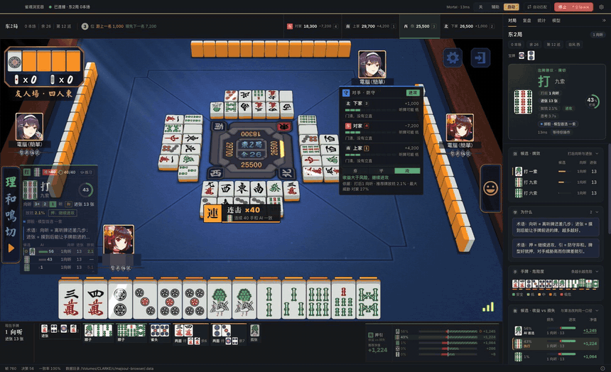
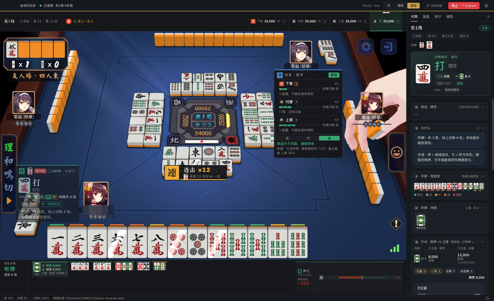
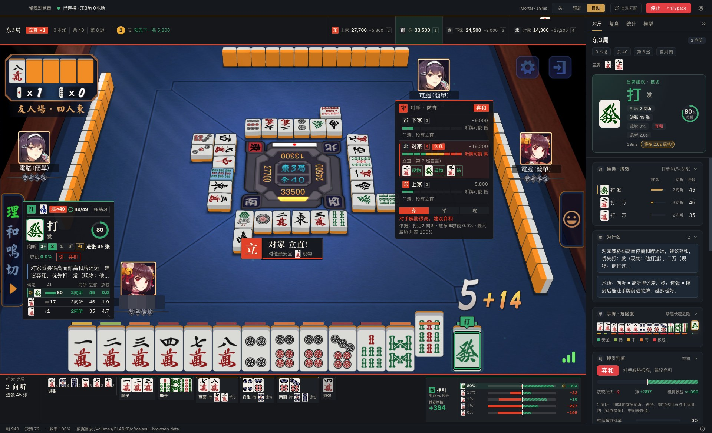
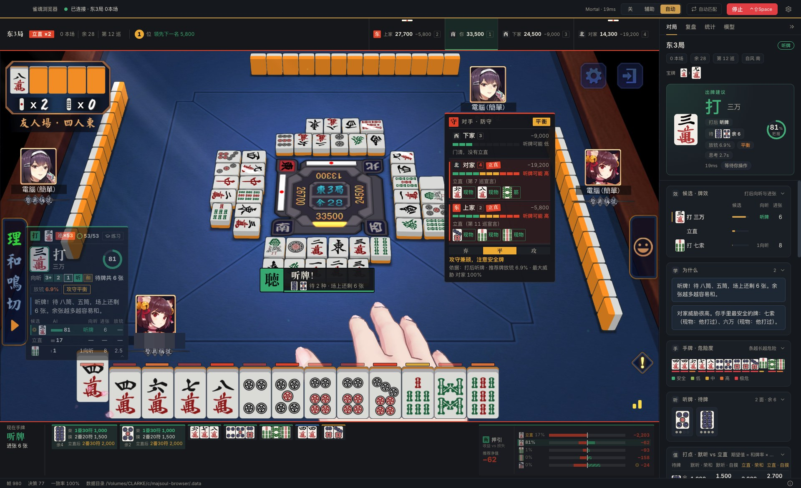
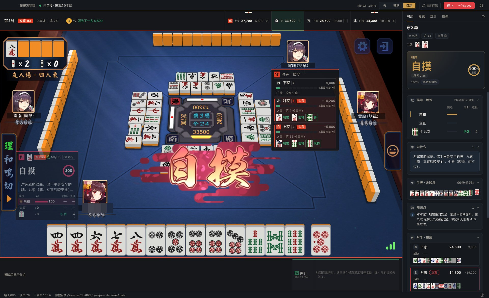
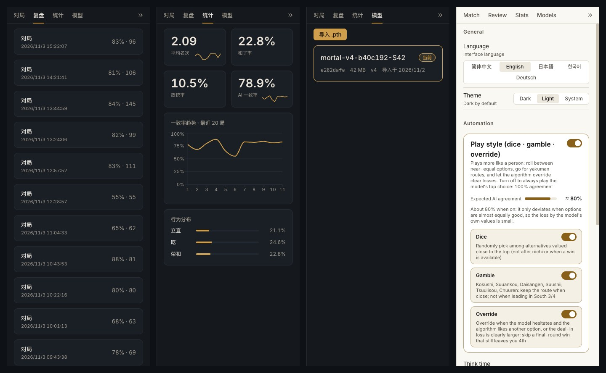
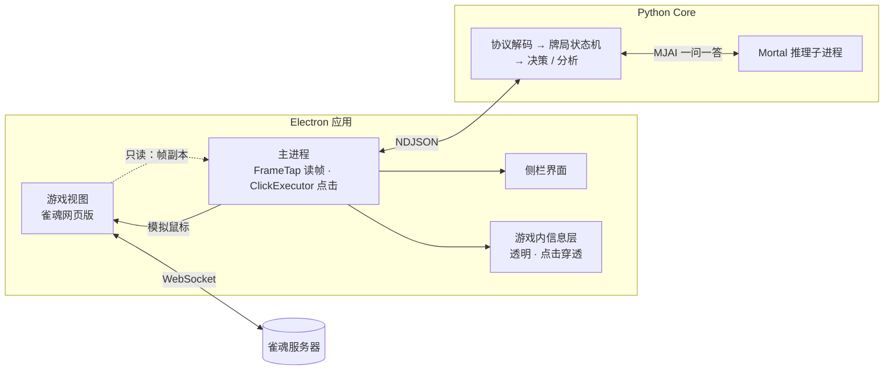
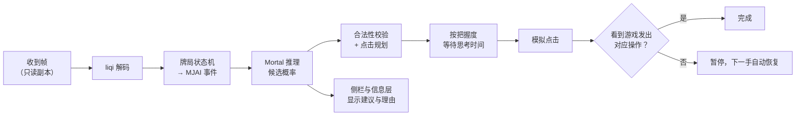

<p align="center"></p>

<h1 align="center">雀魂浏览器 · Majsoul-Browser</h1>

<p align="center">
  内嵌雀魂网页版的桌面浏览器，用本地 Mortal AI 给出四人日麻的出牌建议，<br>
  把推荐、危险度和押引判断直接画在游戏画面上。
</p>

<p align="center">
  <b>简体中文</b> · <a href="docs/README.en.md">English</a> · <a href="docs/README.ja.md">日本語</a> · <a href="docs/README.ko.md">한국어</a> · <a href="docs/README.de.md">Deutsch</a>
  <br>📖 <a href="docs/TECHNICAL.md">技术文档</a> · <a href="docs/TECHNICAL.en.md">Technical docs</a>
</p>

> [!CAUTION]
> 本项目是**非官方**第三方工具，与雀魂（Mahjong Soul）及其运营方没有任何关系，仅供学习参考交流。请使用者于下载 24 小时内自行删除，不得用于商业用途，否则后果自负。
>
> 雀魂官方可能会检测并封号，如产生任何后果与作者无关。使用本项目则表示你已知悉并同意以上条款。

## 效果展示

下面的画面都来自一局真实的友人场人机对局（四人东风），全程由**自动模式**打牌：96 次决策，最终 **一位 · 44,000 点**。用户名已打码。

<p align="center"></p>
<p align="center">AI 立直 → 自摸满贯 8,000 点 → 名次从三位升到一位（2 倍速） · <a href="docs/media/demo.mp4">▶ 观看完整视频（50 秒）</a></p>

| | |
|---|---|
|  |  |
| 自动打牌：立直后满贯听牌，与 AI 连续 12 手一致 | 对家立直：横幅提示最安全的牌，押引判断转为弃和 |
|  |  |
| 两家立直时听牌：待牌、余张与打点一目了然 | AI 选择自摸，并在侧栏给出理由与知识点 |
|  |  |
| 和了画面 | 终局：一位 44,000 点 |

<p align="center"><br>侧栏：复盘 · 统计 · 模型 · 设置（五种界面语言）</p>

## 它能做什么

- **一个窗口就能玩**：内嵌雀魂网页版，登录状态保存在本地；不改系统代理、不装证书、不需要管理员权限。
- **只读不写**：只读取游戏的网络消息来理解牌局，绝不修改、伪造或丢弃任何协议数据；所有操作都通过模拟鼠标点击完成。
- **本地 AI 推理**：使用 [Mortal](https://github.com/Equim-chan/Mortal) 模型在你自己的电脑上推理（CPU 即可），不上传任何数据。
- **游戏内信息层**：在牌桌空白处显示推荐打法、把握度、向听进度、候选对比、每张手牌的危险度条、对手听牌可能与安全牌、押引（攻 / 平 / 弃）结论；听牌、对手立直、名次变化时弹出提示横幅。
- **练习模式**：先隐藏 AI 的答案，你出牌后立刻对比，统计本局一致率与失误。
- **自动打牌（可选）**：按 AI 的决定模拟点击，带思考时间；任何不确定（牌局不同步、模型异常、点击没被确认）都会先停下，下一手自动恢复；随时可以急停。
- **自动匹配、牌谱记录与复盘**、多模型管理、深色 / 浅色主题。
- **五种界面语言**：简体中文、English、日本語、한국어、Deutsch。

## 工作原理

雀魂网页照常运行；外壳通过浏览器调试接口**只读**地拿到它收发的每一帧，交给本地的 Python 大脑和 Mortal 模型，
建议画在一层透明的信息层上；自动模式下再模拟鼠标点击，并且要看到游戏真的发出了对应操作才算完成。



一手牌从收到到打出：



完整的设计与实现（十几张架构图、状态机、坐标系、算法与阈值）见 **[技术文档](docs/TECHNICAL.md)**（[English](docs/TECHNICAL.en.md)）。

## 下载

在 [Releases](../../releases) 页面下载对应平台的压缩包：

| 平台 | 文件 |
|---|---|
| Windows 10/11（x64） | `Majsoul-Browser-<版本>-win-x64.zip` |
| macOS（Apple Silicon，M 系列芯片） | `Majsoul-Browser-<版本>-mac-arm64.zip` |
| macOS（Intel） | `Majsoul-Browser-<版本>-mac-x64.zip` |
| Linux（x64） | `Majsoul-Browser-<版本>-linux-x86_64.AppImage` 或 `.tar.gz` |

这是绿色版：解压后放到一个**可写的文件夹**即可运行，所有数据（登录信息、模型、牌谱、日志、设置）都保存在程序旁边的 `MajsoulBrowserData/` 文件夹里，删掉整个文件夹就是卸载。

<details>
<summary>首次打开的系统提示</summary>

- **macOS**：应用没有经过苹果签名。第一次请右键点击 `Majsoul-Browser.app` →「打开」；如果提示“已损坏”，在终端执行
  `xattr -dr com.apple.quarantine /path/to/Majsoul-Browser.app`。不要直接在“下载”文件夹或压缩包里运行，先把它移到别的文件夹。
- **Windows**：SmartScreen 可能提示“未知发布者”，点「更多信息」→「仍要运行」。
- **Linux**：`chmod +x Majsoul-Browser-*.AppImage` 后运行；数据保存在 AppImage 文件旁边。

</details>

## 准备模型

安装包**不包含 AI 模型**。你需要自己准备一个 Mortal 格式的模型文件（`.pth`，包含 `mortal`、`current_dqn`、`config` 三部分，支持 v1–v4），然后在应用的「模型」页面点「导入」。导入时会校验文件并做一次试推理，通过后就可以在对局中使用。

没有模型时应用也能正常打开和玩游戏，只是没有 AI 建议。

## 使用

1. 打开应用，在内嵌的页面里登录雀魂。
2. 在「模型」页导入并启用模型。
3. 开始一局四人麻将：侧栏和游戏画面上会出现建议。顶部可以在 **关 / 辅助 / 自动** 之间切换。

| 快捷键（macOS 用 ⌘） | 作用 |
|---|---|
| `Ctrl+Shift+Space` | **急停**：立刻停止自动打牌（全局有效） |
| `Ctrl+Shift+A` | 切换辅助 / 关 |
| `Ctrl+Shift+H` | 显示 / 隐藏游戏内信息层 |
| `Ctrl+\` | 折叠侧栏 |
| `Ctrl+,` | 设置 |
| `Ctrl+1` … `Ctrl+4` | 切换侧栏标签 |

只支持四人麻将；三人麻将会自动关闭所有功能。

## 从源码构建

### 需要准备

| 工具 | 版本 | 用途 |
|---|---|---|
| [Node.js](https://nodejs.org/) | 22 | 桌面应用（Electron + React + TypeScript） |
| [pnpm](https://pnpm.io/) | 10 | 前端依赖 |
| [uv](https://docs.astral.sh/uv/) | 最新 | Python 3.12 环境与依赖（会自动下载 Python） |
| [Rust](https://rustup.rs/) | stable | 从源码编译 Mortal 的 libriichi |
| Windows 额外需要 | — | Visual Studio Build Tools（“使用 C++ 的桌面开发”） |

### 开发运行

```bash
git clone https://github.com/ClarkeLi/majsoul-browser.git
cd majsoul-browser

# Python Core（第一次会编译 libriichi 并下载 PyTorch，需要几分钟）
cd core
uv sync
uv run pytest -q                  # 需要模型文件的用例会自动跳过

# 桌面应用
cd ../apps/desktop
pnpm install
pnpm test && pnpm typecheck
SOUL_MODEL=/path/to/mortal.pth pnpm dev     # 也可以不带模型启动，之后在「模型」页导入
```

开发模式的数据保存在仓库里的 `.data/`；也可以用环境变量 `MAJSOUL_BROWSER_DATA_DIR` 指定任意数据目录。

### 打包

一条命令打出当前平台的发布包，输出到仓库根目录的 `release/`：

```bash
scripts/package.sh mac-arm64      # macOS Apple Silicon
scripts/package.sh mac-x64        # macOS Intel（在 Apple Silicon 上也能构建，需要 Rosetta 2）
scripts/package.sh win            # Windows x64（在 Windows 的 Git Bash 里运行）
scripts/package.sh linux          # Linux x64
```

它依次做三件事：`scripts/build-core.sh` 用 PyInstaller 把 Python Core 冻结成 `dist/soul-core/` → 构建前端 → electron-builder 打包。
PyInstaller 不能交叉编译，所以 Windows 和 Linux 版要在对应系统上构建。

> **Intel Mac 说明**：PyTorch 2.2 之后不再提供 macOS x86_64 版本，所以 Intel Mac 上固定使用 torch 2.2.2 + numpy 1.26（`core/pyproject.toml` 里按平台区分）。
> 在 Apple Silicon 上构建 Intel 版需要先安装 Rosetta 2（`softwareupdate --install-rosetta`），脚本会自动添加 `x86_64-apple-darwin` 的 Rust 目标。

更多细节（多平台发布流程、测试与自检命令）见技术文档的[构建、打包与发布](docs/TECHNICAL.md#17-构建打包与发布)和[测试体系](docs/TECHNICAL.md#18-测试体系)。

## 项目结构

```
apps/desktop/   Electron + React + TypeScript（electron-vite）：main / preload / renderer（含游戏内信息层）
core/           Python 3.12：协议解码、四麻状态机、决策与 Mortal 推理，通过 stdio 的 NDJSON 与桌面端通信
vendor/mortal/  Mortal 源码（AGPL-3.0），用于编译 libriichi
scripts/        打包、只读检查、SBOM
test/           端到端测试用的假游戏页面
```

## 设计原则

- **零协议写入**：不向服务器发送、修改或丢弃任何 WebSocket 帧（`scripts/verify-readonly.sh` 在 CI 中强制检查）。
- **零系统改动**：不改代理、不装证书、不需要管理员权限，数据只写在程序旁边。
- **失败即停**：牌局不同步、模型异常、点击目标不确定时停止自动操作，绝不“猜着点”。

## 许可证与致谢

本项目以 [GPL-3.0-or-later](LICENSE) 发布，其中取自 Mortal 的部分保留 AGPL-3.0 条款。感谢：

- [Mortal](https://github.com/Equim-chan/Mortal)（Equim-chan）— 麻将 AI 模型与 libriichi
- [MajsoulMax](https://github.com/Avenshy/MajsoulMax)（Avenshy）— 雀魂协议解码
- [MahjongCopilot](https://github.com/latorc/MahjongCopilot)（latorc）— 点击坐标参考
- [riichi-mahjong-tiles](https://github.com/FluffyStuff/riichi-mahjong-tiles)（FluffyStuff）— 牌面图

详见 [NOTICE](NOTICE)。
