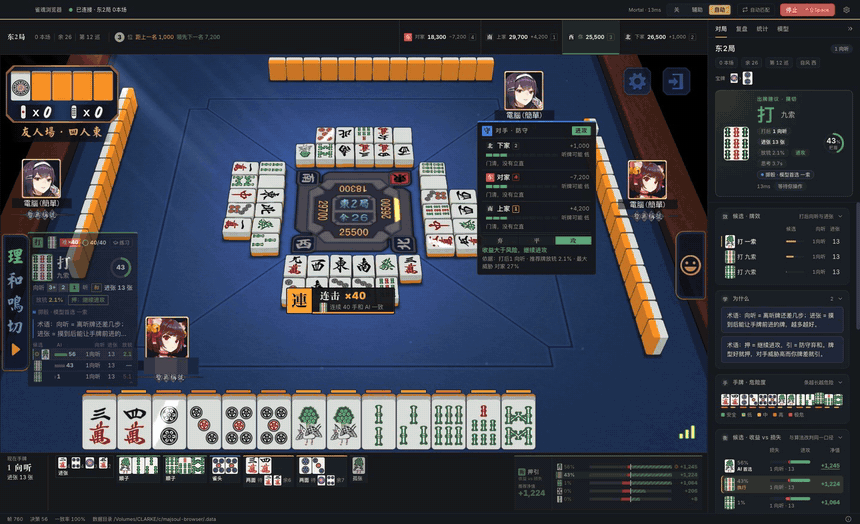
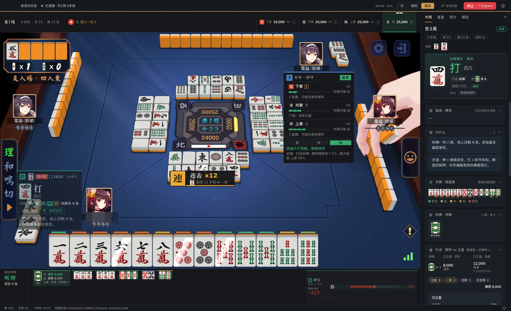
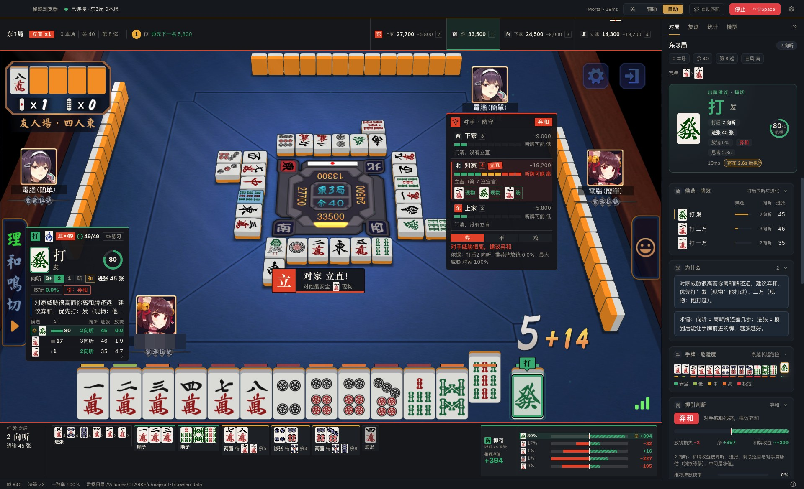
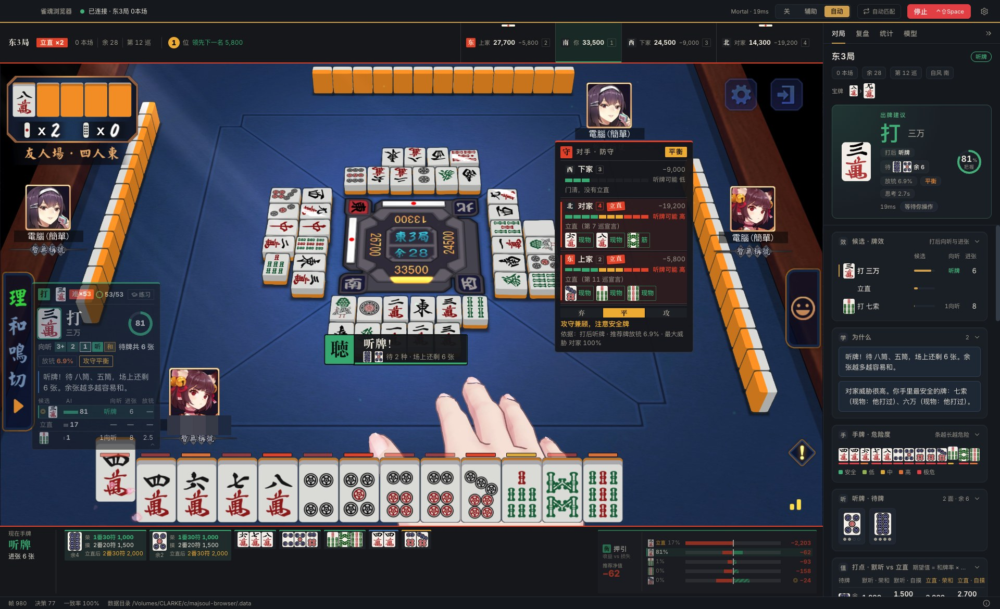
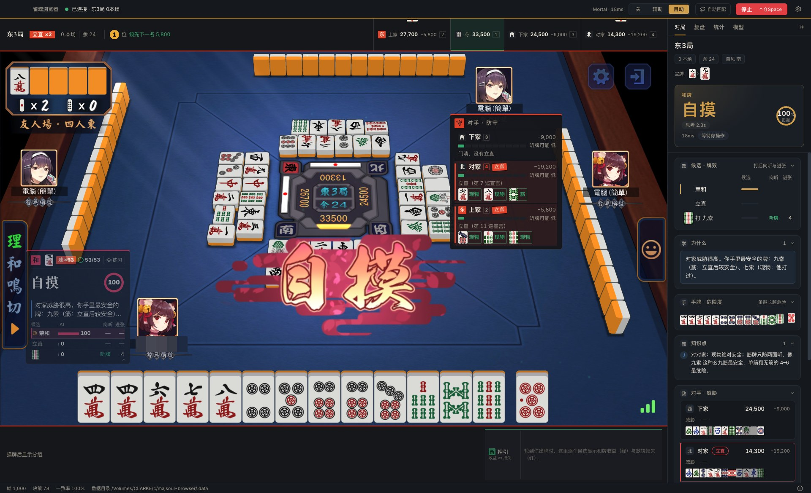
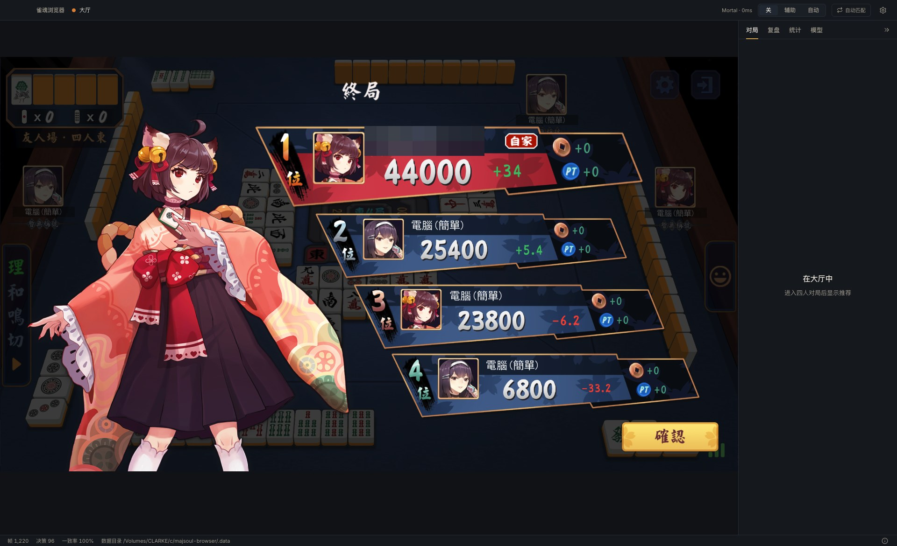
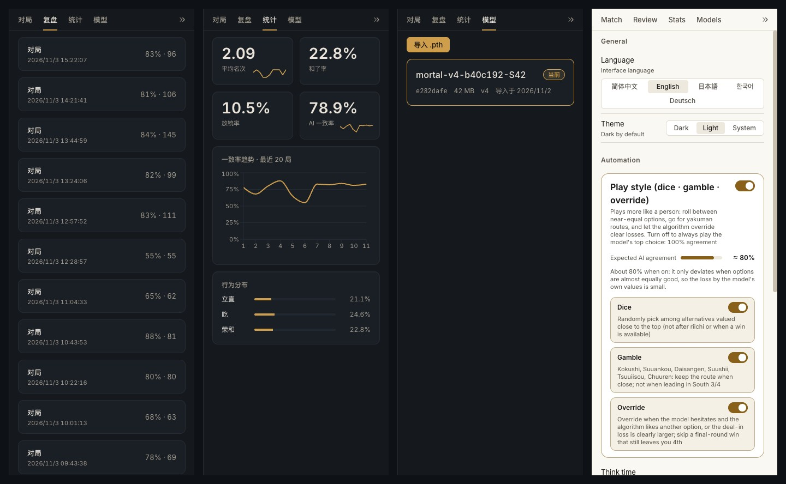
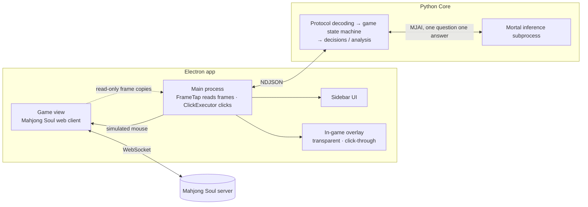
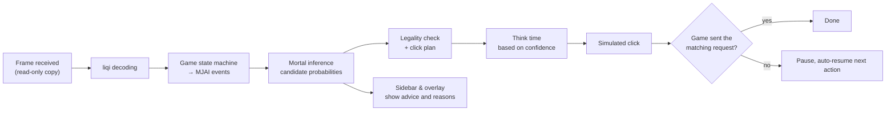

<p align="center"></p>

<h1 align="center">Majsoul-Browser</h1>

<p align="center">
  Ein Desktop-Browser mit eingebautem Mahjong-Soul-Webclient. Eine lokale Mortal-KI schlägt Abwürfe für 4-Spieler-Riichi-Mahjong vor<br>
  und zeichnet Empfehlungen, Gefahrenstufen und Push/Fold-Einschätzungen direkt ins Spielbild.
</p>

<p align="center">
  <a href="../README.md">简体中文</a> · <a href="README.en.md">English</a> · <a href="README.ja.md">日本語</a> · <a href="README.ko.md">한국어</a> · <b>Deutsch</b>
  <br>📖 <a href="TECHNICAL.en.md">Technische Doku</a> · <a href="TECHNICAL.md">技术文档</a>
</p>

> [!CAUTION]
> Dies ist ein **inoffizielles** Drittanbieter-Tool ohne Verbindung zu Mahjong Soul oder dessen Betreibern und dient ausschließlich zum Lernen, als Referenz und zum Austausch. Lösche es innerhalb von 24 Stunden nach dem Download. Kommerzielle Nutzung ist untersagt; andernfalls trägst du alle Folgen selbst.
>
> Mahjong Soul kann die Nutzung erkennen und Konten sperren; der Autor haftet für keinerlei Folgen. Mit der Nutzung dieses Projekts bestätigst du, diese Bedingungen zu kennen und ihnen zuzustimmen.

## In Aktion

Alles unten stammt aus einer echten Freundesrunde gegen Bots (4 Spieler, Ostrunde), komplett im **Auto-Modus** gespielt: 96 Entscheidungen, Ergebnis **Platz 1 mit 44.000 Punkten**. Der Benutzername ist verpixelt.

<p align="center"></p>
<p align="center">KI erklärt Riichi → Tsumo-Mangan (8.000) → von Platz 3 auf Platz 1 (2× Tempo) · <a href="media/demo.mp4">▶ Ganzes Video ansehen (50 s)</a></p>

| | |
|---|---|
|  |  |
| Auto-Play: Mangan-Tenpai nach Riichi, 12 Züge in Folge wie die KI | Riichi des Gegenübers: Banner zeigt den sichersten Stein, Push/Fold schaltet auf Fold |
|  |  |
| Tenpai gegen zwei Riichi: Wartesteine, Restanzahl und Wert auf einen Blick | Die KI nimmt das Tsumo, die Seitenleiste erklärt warum |
|  |  |
| Gewinnbildschirm | Endstand: Platz 1 mit 44.000 Punkten |

<p align="center"><br>Seitenleiste: Analyse · Statistik · Modelle · Einstellungen (fünf Sprachen)</p>

## Was es kann

- **Ein Fenster zum Spielen**: Der Mahjong-Soul-Webclient ist eingebettet, die Anmeldung bleibt lokal gespeichert; keine Änderung des System-Proxys, keine Zertifikate, keine Administratorrechte.
- **Nur lesen, nie schreiben**: Es liest lediglich die Netzwerknachrichten des Spiels, um die Partie zu verstehen, und verändert, fälscht oder verwirft niemals Protokolldaten; alle Aktionen laufen über simulierte Mausklicks.
- **Lokale KI-Inferenz**: Das Modell [Mortal](https://github.com/Equim-chan/Mortal) läuft auf deinem eigenen Rechner (die CPU genügt); es werden keine Daten hochgeladen.
- **Info-Ebene im Spiel**: Auf freien Flächen des Tisches zeigt sie die empfohlene Spielweise, Zuversicht, Shanten-Fortschritt, den Vergleich der Kandidaten, einen Gefahrenbalken für jeden Stein auf deiner Hand, mögliche Wartetiles der Gegner samt sicheren Steinen und ein Push/Fold-Urteil (Angriff / Ausgewogen / Fold). Bei Tenpai, gegnerischem Riichi oder Platzwechsel erscheint ein Hinweisbanner.
- **Übungsmodus**: Die Antwort der KI bleibt zunächst verborgen; nach deinem Abwurf wird sie sofort verglichen, und die Übereinstimmungsquote sowie Fehler dieser Partie werden gezählt.
- **Auto-Play (optional)**: Klickt nach der Entscheidung der KI, mit Bedenkzeit. Bei jeder Unsicherheit (Partie nicht synchron, Modellfehler, nicht bestätigter Klick) hält es zuerst an und macht beim nächsten Zug automatisch weiter. Der Not-Stopp ist jederzeit möglich.
- **Automatisches Matchmaking, Aufzeichnung und Analyse von Game Logs**, Verwaltung mehrerer Modelle, dunkles / helles Design.
- **Fünf Oberflächensprachen**: 简体中文, English, 日本語, 한국어, Deutsch.

## So funktioniert es






Die Diagramme sind auf Englisch. Alle Details zu Design und Implementierung stehen in der **[technischen Dokumentation (Englisch)](TECHNICAL.en.md)** ([中文](TECHNICAL.md)).

## Download

Lade das Archiv für deine Plattform von der Seite [Releases](../../../releases) herunter:

| Plattform | Datei |
|---|---|
| Windows 10/11 (x64) | `Majsoul-Browser-<Version>-win-x64.zip` |
| macOS (Apple Silicon, M-Chips) | `Majsoul-Browser-<Version>-mac-arm64.zip` |
| macOS (Intel) | `Majsoul-Browser-<Version>-mac-x64.zip` |
| Linux (x64) | `Majsoul-Browser-<Version>-linux-x86_64.AppImage` oder `.tar.gz` |

Das ist eine portable Version: Entpacke sie in einen **beschreibbaren Ordner** und starte sie. Alle Daten (Anmeldung, Modelle, Game Logs, Logs, Einstellungen) liegen im Ordner `MajsoulBrowserData/` neben dem Programm; löschst du den ganzen Ordner, ist die App deinstalliert.

<details>
<summary>Systemhinweise beim ersten Start</summary>

- **macOS**: Die App ist nicht von Apple signiert. Klicke beim ersten Mal mit der rechten Maustaste auf `Majsoul-Browser.app` → „Öffnen“. Wenn die Meldung „beschädigt“ erscheint, führe im Terminal aus:
  `xattr -dr com.apple.quarantine /path/to/Majsoul-Browser.app`. Starte sie nicht direkt aus dem Ordner „Downloads“ oder aus dem Archiv, sondern verschiebe sie zuerst in einen anderen Ordner.
- **Windows**: SmartScreen zeigt eventuell „Unbekannter Herausgeber“ an. Klicke auf „Weitere Informationen“ → „Trotzdem ausführen“.
- **Linux**: Führe `chmod +x Majsoul-Browser-*.AppImage` aus und starte die Datei danach; die Daten liegen neben der AppImage-Datei.

</details>

## Modell bereitstellen

Das Paket **enthält kein KI-Modell**. Du musst selbst eine Modelldatei im Mortal-Format bereitstellen (`.pth`, mit den drei Teilen `mortal`, `current_dqn` und `config`; v1–v4 werden unterstützt) und dann auf der Seite „Modell“ der App auf „Importieren“ klicken. Beim Import wird die Datei geprüft und eine Test-Inferenz ausgeführt; wenn beides klappt, kannst du das Modell in Partien nutzen.

Ohne Modell lässt sich die App trotzdem ganz normal öffnen und das Spiel spielen, nur eben ohne KI-Vorschläge.

## Verwendung

1. Öffne die App und melde dich auf der eingebetteten Seite bei Mahjong Soul an.
2. Importiere auf der Seite „Modell“ ein Modell und aktiviere es.
3. Starte eine 4-Spieler-Partie: In der Seitenleiste und im Spielbild erscheinen Vorschläge. Oben kannst du zwischen **Aus / Assistenz / Auto** umschalten.

| Tastenkürzel (auf macOS ⌘ statt Strg) | Wirkung |
|---|---|
| `Ctrl+Shift+Space` | **Not-Stopp**: stoppt Auto-Play sofort (global wirksam) |
| `Ctrl+Shift+A` | Zwischen Assistenz / Aus umschalten |
| `Ctrl+Shift+H` | Info-Ebene im Spiel ein- / ausblenden |
| `Ctrl+\` | Seitenleiste einklappen |
| `Ctrl+,` | Einstellungen |
| `Ctrl+1` … `Ctrl+4` | Tabs der Seitenleiste wechseln |

Unterstützt wird nur 4-Spieler-Mahjong; bei 3-Spieler-Mahjong werden alle Funktionen automatisch abgeschaltet.

## Aus dem Quellcode bauen

### Voraussetzungen

| Tool | Version | Zweck |
|---|---|---|
| [Node.js](https://nodejs.org/) | 22 | Desktop-App (Electron + React + TypeScript) |
| [pnpm](https://pnpm.io/) | 10 | Frontend-Abhängigkeiten |
| [uv](https://docs.astral.sh/uv/) | neueste | Python-3.12-Umgebung und Abhängigkeiten (lädt Python automatisch herunter) |
| [Rust](https://rustup.rs/) | stable | Mortals libriichi aus dem Quellcode kompilieren |
| Zusätzlich unter Windows | — | Visual Studio Build Tools („Desktopentwicklung mit C++“) |

### Im Entwicklungsmodus starten

```bash
git clone https://github.com/ClarkeLi/majsoul-browser.git
cd majsoul-browser

# Python Core (beim ersten Mal wird libriichi kompiliert und PyTorch geladen, das dauert einige Minuten)
cd core
uv sync
uv run pytest -q                  # Tests, die eine Modelldatei brauchen, werden automatisch übersprungen

# Desktop-App
cd ../apps/desktop
pnpm install
pnpm test && pnpm typecheck
SOUL_MODEL=/path/to/mortal.pth pnpm dev     # geht auch ohne Modell; importiere es dann später auf der Seite „Modell“
```

Im Entwicklungsmodus liegen die Daten in `.data/` im Repository; mit der Umgebungsvariable `MAJSOUL_BROWSER_DATA_DIR` kannst du auch ein beliebiges Datenverzeichnis angeben.

### Paketieren

Ein Befehl erstellt das Release-Paket für die aktuelle Plattform und schreibt es nach `release/` im Repository-Stammverzeichnis:

```bash
scripts/package.sh mac-arm64      # macOS Apple Silicon
scripts/package.sh mac-x64        # macOS Intel (lässt sich auch auf Apple Silicon bauen, benötigt Rosetta 2)
scripts/package.sh win            # Windows x64 (in Git Bash unter Windows ausführen)
scripts/package.sh linux          # Linux x64
```

Dabei passieren nacheinander drei Dinge: `scripts/build-core.sh` friert den Python Core mit PyInstaller zu `dist/soul-core/` ein → das Frontend wird gebaut → electron-builder paketiert alles.
PyInstaller kann nicht cross-kompilieren, deshalb müssen die Windows- und Linux-Versionen jeweils auf dem passenden System gebaut werden.

> **Hinweis zu Intel-Macs**: Nach PyTorch 2.2 gibt es keine macOS-x86_64-Builds mehr, deshalb ist auf Intel-Macs torch 2.2.2 + numpy 1.26 fest eingestellt (in `core/pyproject.toml` nach Plattform unterschieden).
> Um die Intel-Version auf Apple Silicon zu bauen, musst du zuerst Rosetta 2 installieren (`softwareupdate --install-rosetta`); das Skript fügt das Rust-Target `x86_64-apple-darwin` automatisch hinzu.

Details zum Release-Workflow für alle Plattformen sowie zu Tests und Selbstprüfungen stehen in der technischen Doku (Englisch): [Build, Packaging and Release](TECHNICAL.en.md#17-build-packaging-and-release) und [Test Suite](TECHNICAL.en.md#18-test-suite).

## Projektstruktur

```
apps/desktop/   Electron + React + TypeScript (electron-vite): main / preload / renderer (inkl. Info-Ebene im Spiel)
core/           Python 3.12: Protokolldekodierung, 4-Spieler-Zustandsautomat, Entscheidungen und Mortal-Inferenz; kommuniziert per NDJSON über stdio mit der Desktop-App
vendor/mortal/  Mortal-Quellcode (AGPL-3.0), zum Kompilieren von libriichi
scripts/        Paketierung, Read-only-Prüfung, SBOM
test/           Fake-Spielseite für End-to-End-Tests
```

## Designprinzipien

- **Keine Protokoll-Schreibzugriffe**: Es werden keine WebSocket-Frames an den Server gesendet, verändert oder verworfen (`scripts/verify-readonly.sh` prüft das verbindlich in der CI).
- **Keine Systemänderungen**: kein Proxy, keine Zertifikate, keine Administratorrechte; Daten werden nur neben dem Programm geschrieben.
- **Bei Fehlern anhalten**: Ist die Partie nicht synchron, das Modell fehlerhaft oder das Klickziel unsicher, stoppen die automatischen Aktionen; es wird nie „auf Verdacht geklickt“.

## Lizenz und Danksagung

Dieses Projekt steht unter der [GPL-3.0-or-later](../LICENSE); die aus Mortal übernommenen Teile behalten die Bedingungen der AGPL-3.0. Danke an:

- [Mortal](https://github.com/Equim-chan/Mortal) (Equim-chan) — Mahjong-KI-Modell und libriichi
- [MajsoulMax](https://github.com/Avenshy/MajsoulMax) (Avenshy) — Dekodierung des Mahjong-Soul-Protokolls
- [MahjongCopilot](https://github.com/latorc/MahjongCopilot) (latorc) — Referenz für Klickkoordinaten
- [riichi-mahjong-tiles](https://github.com/FluffyStuff/riichi-mahjong-tiles) (FluffyStuff) — Bilder der Spielsteine

Mehr dazu in [NOTICE](../NOTICE).
