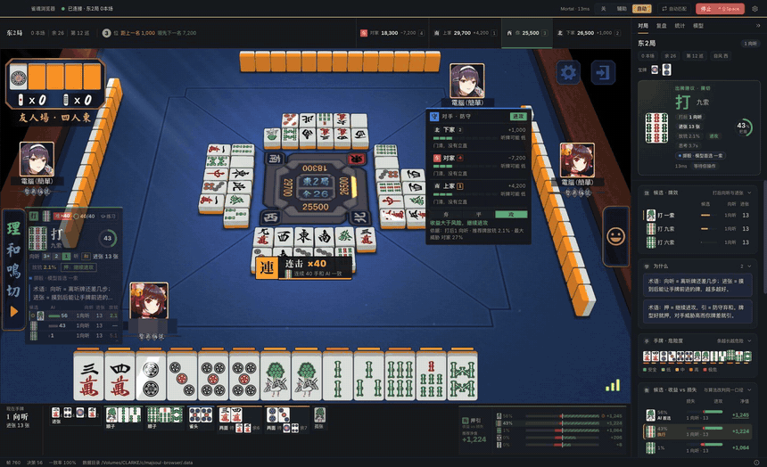
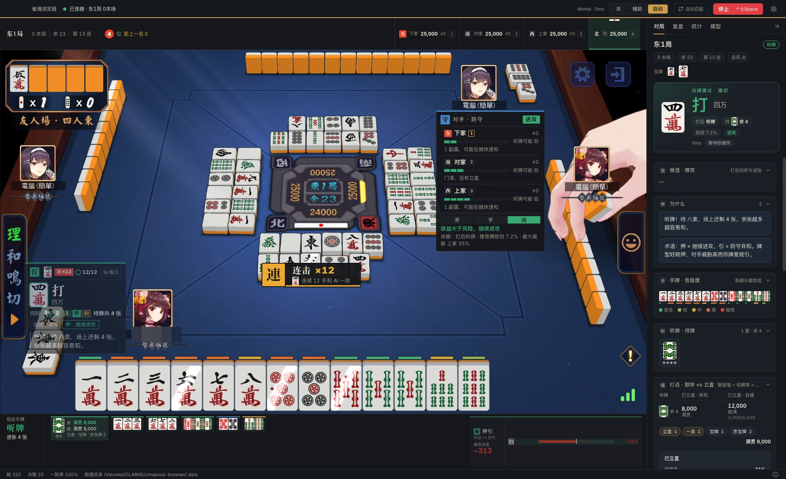
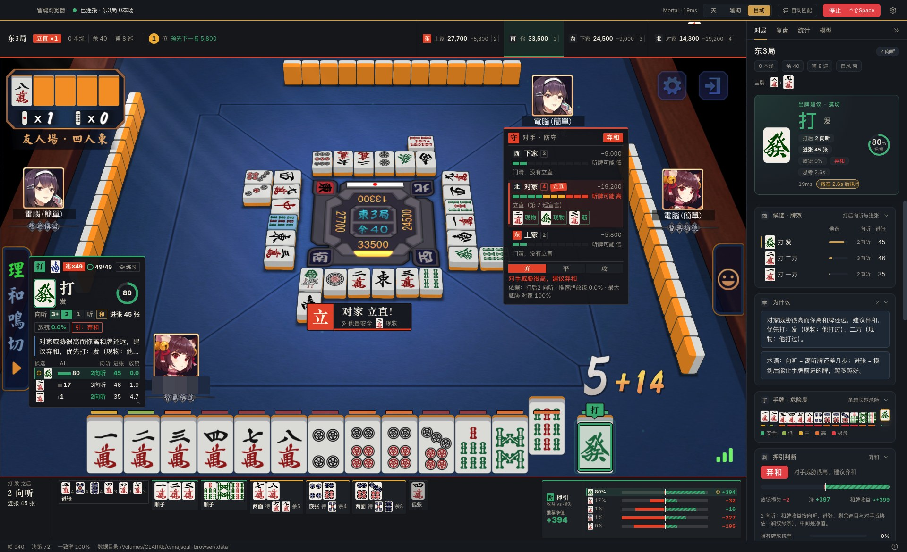
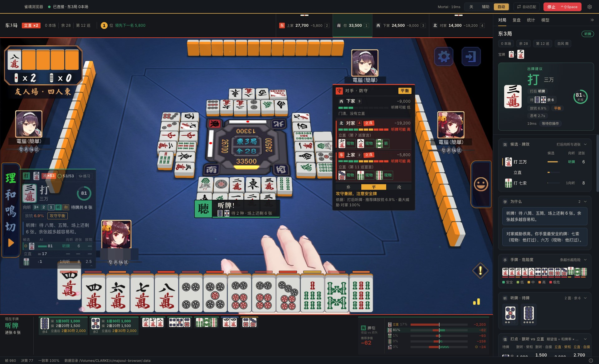
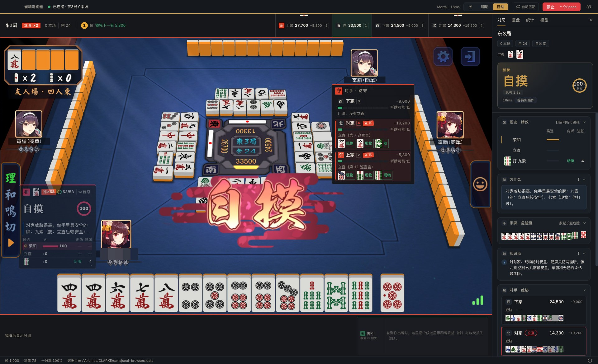
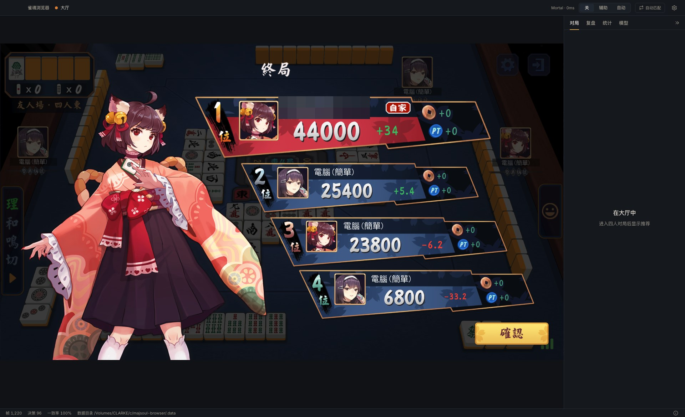
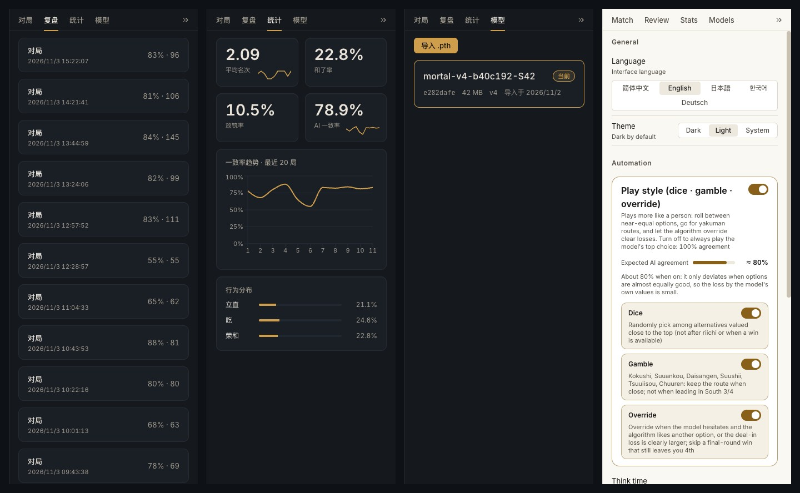
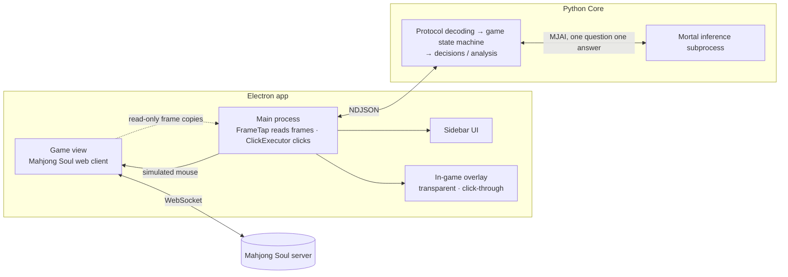
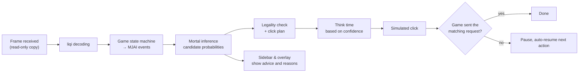

<p align="center"></p>

<h1 align="center">Majsoul-Browser（雀魂ブラウザ）</h1>

<p align="center">
  雀魂のウェブ版を内蔵したデスクトップブラウザ。ローカルの Mortal AI が四人麻雀の打牌を提案し、<br>
  推奨手・危険度・押し引きの判断をゲーム画面の上にそのまま表示します。
</p>

<p align="center">
  <a href="../README.md">简体中文</a> · <a href="README.en.md">English</a> · <b>日本語</b> · <a href="README.ko.md">한국어</a> · <a href="README.de.md">Deutsch</a>
  <br>📖 <a href="TECHNICAL.en.md">技術ドキュメント</a> · <a href="TECHNICAL.md">技术文档</a>
</p>

> [!CAUTION]
> 本プロジェクトは雀魂（Mahjong Soul）およびその運営とは一切関係のない**非公式**のサードパーティ製ツールで、学習・参考・交流のみを目的としています。ダウンロード後 24 時間以内に削除してください。商用利用は禁止します。違反した場合の結果はすべて自己責任です。
>
> 雀魂の運営により検出され、アカウントが停止される可能性があります。いかなる結果についても作者は一切責任を負いません。本プロジェクトを使用した時点で、上記の条項を理解し同意したものとみなします。

## 実際の様子

以下はすべて友人戦の CPU 対局（四人東風戦）を**自動モード**で最後まで打った実録です。判断 96 回、結果は **1 位・44,000 点**。ユーザー名はモザイク処理済みです。

<p align="center"></p>
<p align="center">AI がリーチ → 満貫ツモ 8,000 点 → 3 位から 1 位へ（2 倍速） · <a href="media/demo.mp4">▶ 動画を見る（50 秒）</a></p>

| | |
|---|---|
|  |  |
| 自動打牌：リーチ後に満貫テンパイ、AI と 12 手連続一致 | 対面リーチ：最も安全な牌を表示し、押し引きはベタオリへ |
|  |  |
| 二家リーチ中のテンパイ：待ち・残り枚数・打点がひと目で分かる | AI がツモを選択、サイドバーに理由を表示 |
|  |  |
| 和了画面 | 終局：1 位・44,000 点 |

<p align="center"><br>サイドバー：牌譜 · 統計 · モデル · 設定（5 言語）</p>

## できること

- **ひとつのウィンドウで遊べる**：雀魂のウェブ版を内蔵し、ログイン状態はローカルに保存します。システムのプロキシ変更も証明書のインストールも管理者権限も不要です。
- **読み取り専用**：ゲームの通信メッセージを読み取って局面を把握するだけで、プロトコルデータの改変・偽造・破棄は一切行いません。操作はすべてマウスクリックの模擬で行います。
- **ローカル AI 推論**：[Mortal](https://github.com/Equim-chan/Mortal) モデルを自分の PC 上で推論します（CPU で動作）。データは一切アップロードしません。
- **ゲーム内情報レイヤー**：卓上の空きスペースに、推奨打牌、確信度、向聴の進み具合、候補の比較、手牌ごとの危険度バー、対戦相手の聴牌の可能性と安全牌、押し引き（攻め / 中間 / 降り）の結論を表示します。聴牌、相手の立直、順位変動のときはバナーで知らせます。
- **練習モード**：まず AI の答えを隠し、あなたが打牌した直後に比較して、その局の一致率とミスを集計します。
- **自動打牌（任意）**：AI の判断に従ってクリックを模擬し、思考時間も設けます。不確かな点（局面の同期ずれ、モデルの異常、クリックが確認できない）があるとまず停止し、次の手番で自動的に復帰します。いつでも緊急停止できます。
- **自動マッチング、牌譜の記録と振り返り**、複数モデルの管理、ダーク / ライトテーマ。
- **5 つの表示言語**：简体中文、English、日本語、한국어、Deutsch。

## しくみ






図は英語版です。設計と実装の詳細は **[技術ドキュメント（英語）](TECHNICAL.en.md)**（[中文](TECHNICAL.md)）を参照してください。

## ダウンロード

[Releases](../../../releases) ページから、お使いのプラットフォーム向けのアーカイブをダウンロードしてください。

| プラットフォーム | ファイル |
|---|---|
| Windows 10/11（x64） | `Majsoul-Browser-<バージョン>-win-x64.zip` |
| macOS（Apple Silicon、M シリーズチップ） | `Majsoul-Browser-<バージョン>-mac-arm64.zip` |
| macOS（Intel） | `Majsoul-Browser-<バージョン>-mac-x64.zip` |
| Linux（x64） | `Majsoul-Browser-<バージョン>-linux-x86_64.AppImage` または `.tar.gz` |

ポータブル版です。展開して**書き込み可能なフォルダ**に置けばそのまま動きます。すべてのデータ（ログイン情報、モデル、牌譜、ログ、設定）はプログラムの隣にある `MajsoulBrowserData/` フォルダに保存され、フォルダごと削除すればアンインストールになります。

<details>
<summary>初回起動時のシステム警告</summary>

- **macOS**：アプリは Apple の署名を受けていません。初回は `Majsoul-Browser.app` を右クリックして「開く」を選んでください。「壊れている」と表示された場合は、ターミナルで次を実行します。
  `xattr -dr com.apple.quarantine /path/to/Majsoul-Browser.app`。「ダウンロード」フォルダやアーカイブの中から直接起動せず、先に別のフォルダへ移動してください。
- **Windows**：SmartScreen に「不明な発行元」と表示されることがあります。「詳細情報」→「実行」をクリックしてください。
- **Linux**：`chmod +x Majsoul-Browser-*.AppImage` を実行してから起動します。データは AppImage ファイルの隣に保存されます。

</details>

## モデルの準備

インストールパッケージには **AI モデルは含まれていません**。Mortal 形式のモデルファイル（`.pth`。`mortal`、`current_dqn`、`config` の 3 つを含み、v1〜v4 に対応）をご自身で用意し、アプリの「モデル」ページで「インポート」を押してください。インポート時にファイルを検証して試験推論を行い、通れば対局で使えるようになります。

モデルがなくてもアプリは通常どおり開いてゲームを遊べますが、AI の提案は表示されません。

## 使い方

1. アプリを開き、内蔵ページで雀魂にログインします。
2. 「モデル」ページでモデルをインポートして有効にします。
3. 四人麻雀を始めると、サイドバーとゲーム画面に提案が表示されます。上部で **オフ / 補助 / 自動** を切り替えられます。

| ショートカット（macOS では ⌘） | 動作 |
|---|---|
| `Ctrl+Shift+Space` | **緊急停止**：自動打牌を即座に止めます（グローバルに有効） |
| `Ctrl+Shift+A` | 補助 / オフの切り替え |
| `Ctrl+Shift+H` | ゲーム内情報レイヤーの表示 / 非表示 |
| `Ctrl+\` | サイドバーを折りたたむ |
| `Ctrl+,` | 設定 |
| `Ctrl+1` … `Ctrl+4` | サイドバーのタブ切り替え |

対応しているのは四人麻雀のみです。三人麻雀ではすべての機能が自動的にオフになります。

## ソースからビルドする

### 必要なもの

| ツール | バージョン | 用途 |
|---|---|---|
| [Node.js](https://nodejs.org/) | 22 | デスクトップアプリ（Electron + React + TypeScript） |
| [pnpm](https://pnpm.io/) | 10 | フロントエンドの依存関係 |
| [uv](https://docs.astral.sh/uv/) | 最新 | Python 3.12 環境と依存関係（Python は自動でダウンロードされます） |
| [Rust](https://rustup.rs/) | stable | Mortal の libriichi をソースからコンパイル |
| Windows で追加で必要 | — | Visual Studio Build Tools（「C++ によるデスクトップ開発」） |

### 開発用の実行

```bash
git clone https://github.com/ClarkeLi/majsoul-browser.git
cd majsoul-browser

# Python Core（初回は libriichi のコンパイルと PyTorch のダウンロードがあり、数分かかります）
cd core
uv sync
uv run pytest -q                  # モデルファイルが必要なテストは自動的にスキップされます

# デスクトップアプリ
cd ../apps/desktop
pnpm install
pnpm test && pnpm typecheck
SOUL_MODEL=/path/to/mortal.pth pnpm dev     # モデルなしで起動し、あとから「モデル」ページでインポートすることもできます
```

開発モードのデータはリポジトリ内の `.data/` に保存されます。環境変数 `MAJSOUL_BROWSER_DATA_DIR` で任意のデータディレクトリを指定することもできます。

### パッケージング

1 つのコマンドで現在のプラットフォーム向けのリリースパッケージを作成し、リポジトリ直下の `release/` に出力します。

```bash
scripts/package.sh mac-arm64      # macOS Apple Silicon
scripts/package.sh mac-x64        # macOS Intel（Apple Silicon 上でもビルド可能、Rosetta 2 が必要）
scripts/package.sh win            # Windows x64（Windows の Git Bash で実行）
scripts/package.sh linux          # Linux x64
```

内部では次の 3 つを順に行います。`scripts/build-core.sh` が PyInstaller で Python Core を `dist/soul-core/` に固める → フロントエンドをビルド → electron-builder でパッケージ化。
PyInstaller はクロスコンパイルできないため、Windows 版と Linux 版はそれぞれの OS 上でビルドする必要があります。

> **Intel Mac についての注意**：PyTorch は 2.2 以降 macOS x86_64 版を提供していないため、Intel Mac では torch 2.2.2 + numpy 1.26 に固定しています（`core/pyproject.toml` でプラットフォームごとに分けています）。
> Apple Silicon 上で Intel 版をビルドするには、先に Rosetta 2 をインストールしてください（`softwareupdate --install-rosetta`）。スクリプトが Rust のターゲット `x86_64-apple-darwin` を自動的に追加します。

マルチプラットフォームのリリース手順やテスト・セルフチェックの詳細は、技術ドキュメント（英語）の [Build, Packaging and Release](TECHNICAL.en.md#17-build-packaging-and-release) と [Test Suite](TECHNICAL.en.md#18-test-suite) を参照してください。

## プロジェクト構成

```
apps/desktop/   Electron + React + TypeScript（electron-vite）：main / preload / renderer（ゲーム内情報レイヤーを含む）
core/           Python 3.12：プロトコルのデコード、四人麻雀のステートマシン、判断と Mortal 推論。stdio 上の NDJSON でデスクトップ側と通信
vendor/mortal/  Mortal のソース（AGPL-3.0）。libriichi のコンパイルに使用
scripts/        パッケージング、読み取り専用チェック、SBOM
test/           エンドツーエンドテスト用の偽のゲームページ
```

## 設計方針

- **プロトコルへの書き込みゼロ**：WebSocket フレームの送信・改変・破棄を一切行いません（`scripts/verify-readonly.sh` が CI で強制チェックします）。
- **システム変更ゼロ**：プロキシ変更なし、証明書なし、管理者権限なし。データはプログラムの隣にだけ書き込みます。
- **失敗したら止まる**：局面の同期ずれ、モデルの異常、クリック対象が不確かなときは自動操作を停止し、「当てずっぽうでクリック」は決してしません。

## ライセンスと謝辞

本プロジェクトは [GPL-3.0-or-later](../LICENSE) で公開されており、Mortal 由来の部分は AGPL-3.0 の条項を引き継いでいます。以下に感謝します。

- [Mortal](https://github.com/Equim-chan/Mortal)（Equim-chan）— 麻雀 AI モデルと libriichi
- [MajsoulMax](https://github.com/Avenshy/MajsoulMax)（Avenshy）— 雀魂のプロトコルデコード
- [MahjongCopilot](https://github.com/latorc/MahjongCopilot)（latorc）— クリック座標の参考
- [riichi-mahjong-tiles](https://github.com/FluffyStuff/riichi-mahjong-tiles)（FluffyStuff）— 牌の画像

詳細は [NOTICE](../NOTICE) を参照してください。
