# 雀魂浏览器 Majsoul-Browser · Technical Documentation

[简体中文](TECHNICAL.md) · **English**

> The goal of this document: **you should be able to rebuild the whole project from this document alone.**
> Every chapter has two layers: the "💡 In plain words" box at the start is for readers with no programming background, and the details that follow are for engineers.
> All numbers, thresholds and constants are taken directly from the source code, with the origin noted in the text (`file:function`) so you can cross-check.

<p align="center"></p>

## Table of Contents

1. [One-Minute Overview](#1-one-minute-overview)
2. [Glossary](#2-glossary)
3. [Architecture Overview](#3-architecture-overview)
4. [The Complete Journey of One Hand](#4-the-complete-journey-of-one-hand)
5. [Data Capture: Read-Only “Eavesdropping” on the Game](#5-data-capture-read-only-eavesdropping-on-the-game)
6. [IPC: Electron ⇄ Core](#6-ipc-electron--core)
7. [Protocol Decoding: Turning Binary Frames into Readable Messages](#7-protocol-decoding-turning-binary-frames-into-readable-messages)
8. [Game State Machine: The Single Source of Truth](#8-game-state-machine-the-single-source-of-truth)
9. [AI Inference: Mortal and the Inference Subprocess](#9-ai-inference-mortal-and-the-inference-subprocess)
10. [Decision Layer: From “What the Model Wants to Discard” to “Where to Click”](#10-decision-layer-from-what-the-model-wants-to-discard-to-where-to-click)
11. [Execution Layer: Simulated Clicks and “Stop on Failure”](#11-execution-layer-simulated-clicks-and-stop-on-failure)
12. [Analysis Modules: Efficiency, Defense, Value, Push/Fold](#12-analysis-modules-efficiency-defense-value-pushfold)
13. [UI: Main Window, Sidebar and In-Game Overlay](#13-ui-main-window-sidebar-and-in-game-overlay)
14. [Auto-Matchmaking: Finding Buttons by Looking at the Screen](#14-auto-matchmaking-finding-buttons-by-looking-at-the-screen)
15. [Data, Models and Security Boundaries](#15-data-models-and-security-boundaries)
16. [Internationalization](#16-internationalization)
17. [Build, Packaging and Release](#17-build-packaging-and-release)
18. [Test Suite](#18-test-suite)
19. [Roadmap for Rebuilding from Scratch](#19-roadmap-for-rebuilding-from-scratch)
20. [Known Limitations and Extension Points](#20-known-limitations-and-extension-points)

---

## 1. One-Minute Overview

> 💡 **In plain words**: Majsoul-Browser is a "browser with a built-in co-pilot". You play Mahjong Soul in it as usual, and it **listens without ever speaking**: it reads the game,
> hands the position to a mahjong AI (Mortal) installed on your computer, and draws the AI's advice on top of the game screen.
> With auto mode on, it moves the mouse and clicks like a human, and stops by itself whenever it is not sure.

It consists of three parts:

| Part | Written in | What it does |
|---|---|---|
| **Desktop shell** (apps/desktop) | Electron + React + TypeScript | Shows the Mahjong Soul web page, reads network messages, draws the UI and overlay, simulates mouse clicks |
| **Brain** (core) | Python 3.12 | Decodes the protocol, maintains the game state, calls the AI, computes efficiency / danger / value, decides where to click |
| **AI model** (user-supplied) | PyTorch model file `.pth` | Mortal 4-player model: takes game events, outputs a score for every action |

Three non-negotiable principles (running through the whole design):

1. **Zero protocol writes**: never send, modify or drop any data to or from the server; every action is done only by simulating the mouse.
2. **Zero system changes**: no proxy changes, no certificate installation, no administrator rights; data is written only next to the program.
3. **Stop on failure**: any uncertainty (game state mismatch, model error, unconfirmed click) stops automatic operation; it never "clicks on a guess".

---

## 2. Glossary

<details open>
<summary><b>Mahjong terms</b></summary>

| Term | Meaning |
|---|---|
| 4-player mahjong / Japanese mahjong | Four-player riichi mahjong (this project supports four players only) |
| Shanten | How many steps away from tenpai; 0 = tenpai, -1 = already won |
| Tenpai | One more correct tile completes the hand |
| Ukeire | The tiles that reduce the shanten number, and how many of them remain |
| Riichi | Declared when a closed hand is tenpai; the hand can no longer be changed afterwards |
| Meld (calling) | Chi / pon / kan on a tile discarded by another player |
| Deal-in | Your discard is ronned by another player |
| Genbutsu / suji / kabe | Classic methods for judging whether a tile is safe against a given player |
| Push / Fold | Keep attacking, or give up on winning and switch to defense |
| Han / fu / yaku | The rules used to compute value (score) |
| Furiten | You cannot ron on a tile you have discarded yourself |

</details>

<details open>
<summary><b>Technical terms</b></summary>

| Term | Meaning |
|---|---|
| Electron | A framework for writing desktop programs with web technologies; ships with a Chromium browser |
| Main process / renderer process | Electron's "back-office manager" and the "process that displays web pages" |
| WebContentsView | A region in Electron that can load a web page (used here to host Mahjong Soul) |
| CDP | Chrome DevTools Protocol, the browser debugging interface; used here only to **read** network messages and send mouse events |
| WebSocket frame | One message between the game and the server |
| Protobuf | Google's binary data format; Mahjong Soul uses it to encode messages |
| NDJSON | One JSON object per line, used to pass messages between two processes |
| MJAI | The common event format for mahjong AIs (`{"type":"dahai","pai":"5m",…}`) |
| Mortal | An open-source deep reinforcement learning mahjong AI |
| libriichi | Mortal's Rust core library, responsible for rules and feature encoding |
| PyInstaller | Packages a Python program into an executable that does not require Python to be installed |
| intent | A term of this project: one "operation to execute", with an id, steps and an expiry |
| revision | A term of this project: the version number of the game state, +1 for every message, used to tell whether a recommendation is stale |

</details>

---

## 3. Architecture Overview

> 💡 **In plain words**: After startup the program runs several "little programs" (processes) at the same time, each with its own job: one displays the web page, one draws the UI,
> one sits transparently on top of the game drawing hints, and one is the Python brain, which in turn starts a subprocess dedicated to running the AI.
> They cooperate by "passing notes" (messages), and a problem in any one of them does not drag down the others.

### 3.1 Process Overview

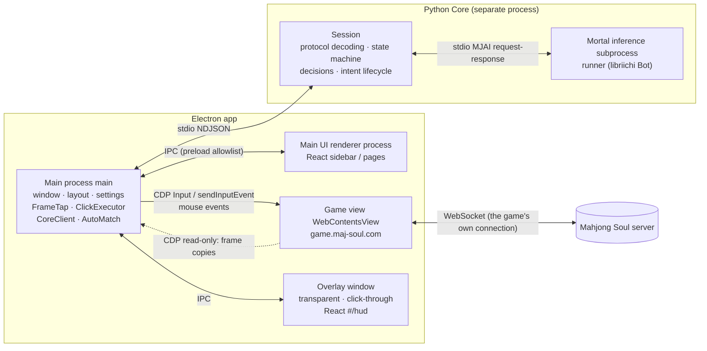

| Process | Entry point | Responsibility | After a crash |
|---|---|---|---|
| Main process | `apps/desktop/src/main/index.ts` | Creates windows, lays them out, reads frames, forwards messages, executes clicks, supervises Core | App exits |
| Main UI renderer process | `src/renderer/main.tsx` → `App.tsx` | Sidebar, Models / Review / Stats / Settings pages | Can be reloaded |
| Game view | `WebContentsView`, partition `persist:majsoul` | Runs the Mahjong Soul web page unmodified | User can reload |
| Overlay window | `#/hud` route of the same renderer bundle | Draws the hints on top of the game screen | After a reload, the cached latest state is replayed |
| Core | `core/src/soul_core/main.py` | Decoding, state machine, decisions, analysis | **Automatic restart with exponential backoff**, session commands are replayed |
| Inference subprocess | `soul_core/inference/runner.py` | Loads the model, produces a reaction for each event | Out of sync for this game, rebuilt automatically next game |

### 3.2 Tech Stack

| Layer | Choice | Why |
|---|---|---|
| Desktop framework | Electron 45 | Built-in Chromium can run the Mahjong Soul web client unmodified; `webContents.debugger` provides in-process CDP, no debug port needed |
| Build | electron-vite + Vite + TypeScript 7 | main / preload / renderer bundles built in one go |
| UI | React 19 + CSS Modules + Zustand | Component-based; Zustand is small and sufficient |
| i18n | i18next | Five languages; the type system guarantees the keys are identical in every language |
| Brain | Python 3.12 (managed by uv) | Mortal is a PyTorch model, so the Python ecosystem is the natural fit |
| AI | Mortal (PyTorch) + libriichi (Rust, PyO3) | One of the strongest open-source riichi mahjong AIs |
| Value | `mahjong` library | Computes yaku, han, fu, points |
| Packaging | PyInstaller (Core) + electron-builder (shell) | Users do not need to install Python / Node |

### 3.3 Directory Structure

```
majsoul-browser/
├── apps/desktop/                 Electron app
│   ├── src/main/                 Main process: index.ts (assembly), frame-tap, core-client, click-executor,
│   │                             overlay, layout, auto-match, settings, paths, models, recorder, i18n
│   ├── src/preload/              Allowlisted API exposed to the renderer (window.soul)
│   ├── src/renderer/             React: features/ (pages and cards), hud/ (in-game overlay), stores/, i18n/
│   ├── src/shared/               Shared by main process and renderer: protocol (message types), ui-map (click coordinates),
│   │                             layout-fit (16:9 layout), overlay-shapes, lang
│   ├── resources/                Tile SVGs, fonts, icons
│   └── scripts/                  End-to-end tests, screenshots, icon generation
├── core/src/soul_core/           Python Core
│   ├── main.py / ipc.py          NDJSON entry point
│   ├── session.py                Session: ties all the modules below together
│   ├── protocol/                 liqi protocol decoding (read-only), proto definitions
│   ├── game/                     Game state machine, hand, tile names
│   ├── inference/                Model architecture, engine, inference subprocess and client
│   ├── decision/                 Action space, legality validation, click planning, thinking time, play style, algorithmic override
│   ├── analysis/                 Efficiency, grouping, defense, value, push/fold, teaching tips, knowledge points
│   ├── models.py                 Model import and validation
│   ├── records.py / review.py    Game records, review and statistics
├── vendor/mortal/                Mortal source (AGPL-3.0), used to compile libriichi
├── scripts/                      Packaging, read-only check, SBOM
└── .github/workflows/            CI and release
```

---

## 4. The Complete Journey of One Hand

> 💡 **In plain words**: The server tells the game "you drew a 5-man, you may discard". That message is copied and handed to the brain;
> the brain updates the game, asks the AI, and the AI says "discard 9-sou". The brain works out "the 9-sou is the 11th tile in the hand", waits a while according to how hesitant the AI was,
> then has the shell move the mouse over and click; finally, only when the brain sees the game actually send the "discard 9-sou" request is the action considered done.

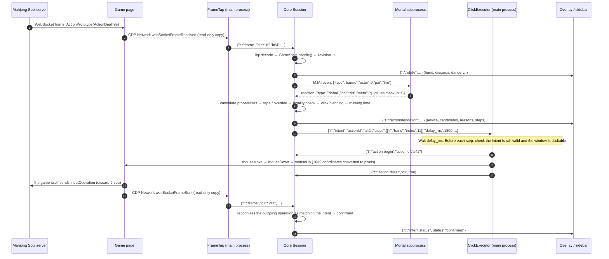

Key points:

- **Nobody speaks for the game**: the request in step 14 is sent by the game page **itself** because it received a mouse click. The project merely "sees" it and uses it to confirm that the click took effect.
- **Revision guards against staleness**: revision is +1 at step 4; if new messages arrive during inference (someone else calls a tile, etc.), step 9 finds the revision changed before publishing and discards this recommendation.
- **Every layer can veto**: an illegal model reaction, no click plan, not enough time, a minimized window, an intent invalidated by a new message... any one of these prevents the action from being executed.

---

## 5. Data Capture: Read-Only “Eavesdropping” on the Game

> 💡 **In plain words**: The browser comes with a "listener" meant for developers. We turn on only its "network listening" feature
> and get a **photocopy** of every message the game sends and receives; the originals are delivered as usual, without a single byte changed.

### 5.1 FrameTap (`src/main/frame-tap.ts`)

- Uses **in-process** CDP via `webContents.debugger.attach('1.3')`; no debug port is opened, so external programs cannot connect.
- **Method allowlist**: `cdp()` allows only the methods below; anything else throws:

  | Purpose | Allowed CDP methods |
  |---|---|
  | Reading the network | `Network.enable`, `Target.setAutoAttach` |
  | Clicking (alternative backend) | `Input.dispatchMouseEvent` |
  | Focus emulation | `Emulation.setFocusEmulationEnabled` |

- Listens to `Network.webSocketFrameReceived / Sent` and **forwards binary frames only** (`opcode === 2`); the connection id is `sessionId:requestId`.
- `Target.setAutoAttach({flatten:true})`: if the WebSocket is opened inside a Worker / iframe, child targets are attached automatically and `Network.enable` is turned on for them too.

**Startup order (empirical finding)**: calling `Network.enable` before the renderer process has been created hangs forever, so it must go:

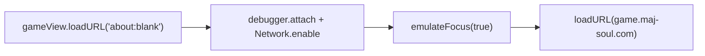

**Focus emulation**: after switching to another application, the Unity version of Mahjong Soul thinks it has lost focus and ignores input, so clicks "don't register".
`Emulation.setFocusEmulationEnabled(true)` makes the page always believe it has focus; it is set again every time a page finishes loading.

### 5.2 Read-Only Guards

| Line of defense | Location | Content |
|---|---|---|
| Runtime allowlist | `frame-tap.ts` | Only the CDP methods in the table above are allowed |
| Static check | `scripts/verify-readonly.sh` (mandatory in CI) | Uses ripgrep to search for `Fetch.`, `Runtime.evaluate`, `setRequestInterception`, `.send(…WebSocket` and the like; `inputOperation` may appear only in read-only parsing code and tests |
| Protocol layer | `core/protocol/outgoing.py` | Only **recognizes** operation requests sent by the client, never constructs them |
| Navigation allowlist | `navigation-policy.ts` | The game view may navigate only to https URLs on `maj-soul.com / majsoul.com / mahjongsoul.com / yo-star.com / catfood.com`; permission requests are always denied |

### 5.3 Running in the Background

When you switch to another application or the window is occluded, Chromium by default lowers the frame rate and timer precision of background pages, and the game screen freezes. The launch switches turn these optimizations off:

```ts
app.commandLine.appendSwitch('disable-renderer-backgrounding')
app.commandLine.appendSwitch('disable-background-timer-throttling')
app.commandLine.appendSwitch('disable-backgrounding-occluded-windows')
// Game view and overlay: webPreferences.backgroundThrottling = false
```

---

## 6. IPC: Electron ⇄ Core

> 💡 **In plain words**: The shell and the brain are two independent programs that talk by "one note per line": the shell writes one line of JSON into the brain's input,
> and the brain writes one line of JSON back on its output. If the brain exits unexpectedly, the shell restarts it after a short while and tells it the "current settings" again.

### 6.1 Transport Format

- **NDJSON over stdio**: commands on stdin, events on stdout, logs on stderr (`core/ipc.py: Emitter` is lock-protected, so writes from multiple threads never interleave).
- Message types are hand-written in `apps/desktop/src/shared/protocol.ts`; both ends share the same contract (Core's tests check against JSON fixtures).
- **Version handshake**: Core first sends `{"t":"ready","protocolVersion":1}` on startup; if the versions differ, the main process shows a dialog and stops, never running "half-compatible".

### 6.2 Message Overview

| Direction | Message | Purpose |
|---|---|---|
| → Core | `hello` | Handshake, carries the protocol version |
| → Core | `ws.open` / `ws.close` / `frame` | WebSocket connections and frames (base64) |
| → Core | `mode.set` | Off / Assist / Auto |
| → Core | `auto.pause` / `auto.resume` | Pause (on minimize, etc.) / resume |
| → Core | `model.activate` | Switch model (during a game it is only registered, taking effect next game) |
| → Core | `action.begin` / `action.result` | Click started / click result |
| → Core | `config` | Record directory, whether to record, play-style switches |
| → Core | `review.list` / `review.get` / `stats.get` | Review and statistics |
| ← Core | `ready` | Ready + version |
| ← Core | `state` | Game snapshot (hand, discards, melds, points, analysis) |
| ← Core | `recommendation` | Recommendation, candidates, efficiency, push/fold, teaching tips, click steps |
| ← Core | `intent` / `intent.status` | The operation to execute / its outcome |
| ← Core | `session.status` | Phase, mode, pause reason, model status |
| ← Core | `model.status` / `error` / `log` | Model, errors, logs |
| ← Core | `lobby.match` / `lobby.matched` / `game.end` | Lobby events used by auto-matchmaking |

### 6.3 Supervision and Restart (`src/main/core-client.ts`)

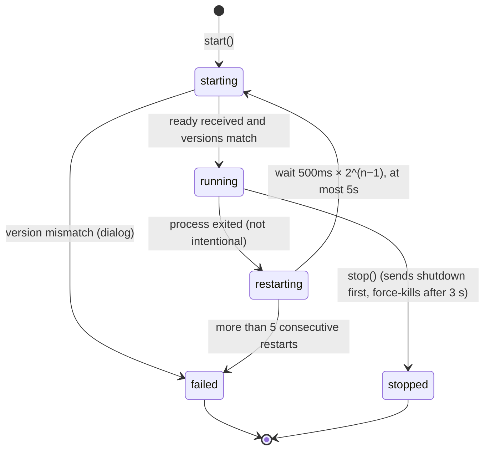

- **Sticky commands**: `config`, `mode.set` and `model.activate` are remembered and re-sent every time Core becomes ready again, so a restart is almost invisible to the user.
- When the overlay window reloads, the main process replays the cached latest `state / recommendation / session.status / model.status` (`hudCache`).

---

## 7. Protocol Decoding: Turning Binary Frames into Readable Messages

> 💡 **In plain words**: The game's messages are compressed binary "ciphertext". Following the publicly available format description (the proto definitions), we restore them to
> structures like "this action, this data"; some of the data was also lightly obfuscated with XOR, which we undo as well.

### 7.1 Frame Format (`core/protocol/liqi.py`)

<p align="center">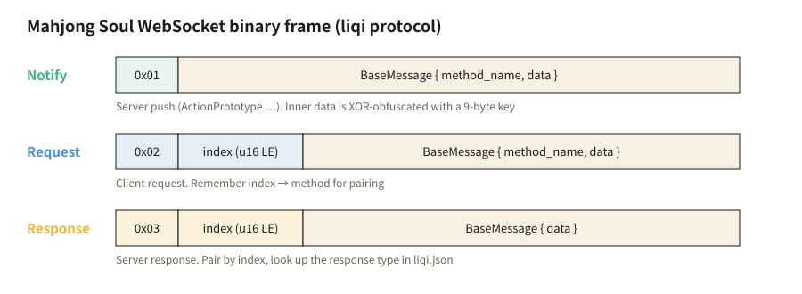</p>

- Byte 1 is the type: `1 Notify` (server push), `2 Request` (client request), `3 Response` (server response).
- Requests / responses carry a 2-byte little-endian `index`; each connection maintains its own `index → (method name, response type)` map, which is paired and popped when the response arrives; a duplicate index or an orphan response is treated as an anomaly.
- The message body is a protobuf `BaseMessage`; method name → request / response type is looked up in `protocol/data/liqi.json`.
- `ActionPrototype` inside a Notify has one more layer: the `data` field is base64-decoded and then XORed:

  ```python
  keys = [0x84, 0x5E, 0x4E, 0x42, 0x39, 0xA2, 0x1F, 0x60, 0x1C]
  for i, byte in enumerate(buf):
      u = ((23 ^ len(buf)) + 5 * i + keys[i % 9]) & 0xFF
      buf[i] = byte ^ u
  ```

### 7.2 Messages Core Cares About (`protocol/sync.py: METHODS`)

| Method | Meaning |
|---|---|
| `.lq.Lobby.login` / `oauth2Login` | Records our own account id (used to determine the seat) |
| `.lq.FastTest.authGame` | Entering a game: seat, rules, players |
| `.lq.FastTest.syncGame` | Reconnection: replays all actions that already happened in one go (plaintext, no XOR) |
| `.lq.ActionPrototype` | Every action in a game (draw, discard, meld, win, draw game, new round…) |
| `.lq.NotifyGameEndResult` / `NotifyGameTerminate` | Game ended |
| `.lq.FastTest.inputOperation` / `inputChiPengGang` (outgoing) | Operations sent by the client, **used only to confirm clicks and to recognize manual operations** |
| `.lq.Lobby.startUnifiedMatch` (outgoing) / `NotifyMatchGameStart` | Used by auto-matchmaking: queue started / match found |

---

## 8. Game State Machine: The Single Source of Truth

> 💡 **In plain words**: The brain keeps a "scoreboard" recording everyone's hand, discards, melds, riichi and points. It **trusts only** messages from the server
> and updates once for every message received. As soon as something does not add up (for example the tile to be discarded is not in the hand), it marks the scoreboard "desynced" and gives no more advice until the next round begins.

### 8.1 Responsibilities (`core/game/state.py: GameState`)

- **Purely functional**: input `(method, name, data)`, output `Output`; no I/O at all, which makes replay tests with recorded frames easy.
- Maintains: own seat, hand (**stored in server order**, see 8.3), drawn tile, the four players' discards (each tile with a global sequence number `seq`), melds, riichi / ippatsu, dora indicators, points, honba / riichi sticks, remaining tiles, furiten, and the currently available operations (`operation`).
- Translates server actions into **MJAI events** fed to Mortal:

| Server action | MJAI events produced |
|---|---|
| `authGame` (4-player) | Rebuild the inference subprocess for our seat + `start_game` |
| `ActionNewRound` | `start_kyoku` (round wind, round number, honba, riichi sticks, dora, dealer, points, own starting hand) |
| `ActionDealTile` | `tsumo` (other players' draws are `?`); new dora → `dora` |
| `ActionDiscardTile` | Riichi declaration → `reach`; `dahai`; when the next action is not a ron → `reach_accepted` |
| `ActionChiPengGang` | `chi` / `pon` / `daiminkan` (with consumed) |
| `ActionAnGangAddGang` | `ankan` / `kakan` |
| `ActionHule` | `hora` → `end_kyoku` |
| `ActionNoTile` / `ActionLiuJu` | `ryukyoku` → `end_kyoku` |
| `NotifyGameEndResult` | `end_game`, releases the inference subprocess |

`Output` structure: `events` (fed to the model in order), `decide_from` (only reactions produced by events from this index on count as decision points; earlier ones do not during a reconnect replay), `restart_seat` (the subprocess must be rebuilt for this seat), `stop_worker`, `fresh_round` (the first discard of a new round waits a bit longer).

### 8.2 Phases and Desync

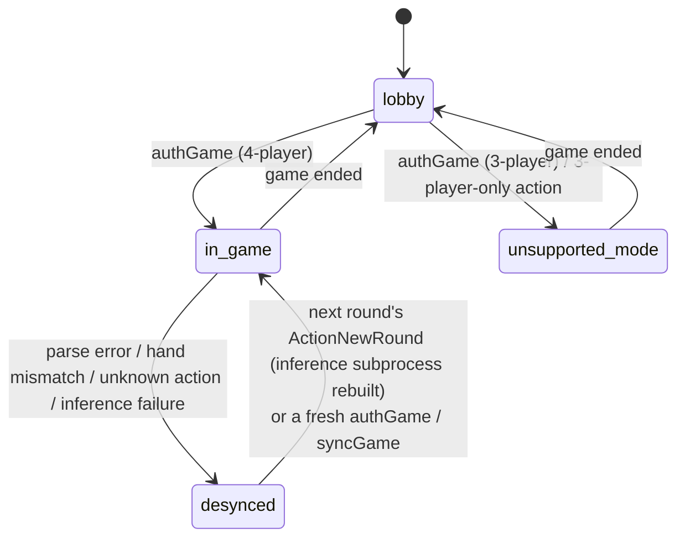

- `handle()` has an outer `try/except`: **any exception becomes only a desync and never crashes Core**.
- On desync: the current intent is cancelled (`desync`), no more events are fed, no recommendations are produced, and the UI shows the reason.
- `revision`: +1 for every message. Recommendations and intents carry it; it is compared before publishing / executing, and stale ones are dropped.

### 8.3 Three Tile Notations (`game/tiles.py`, `game/hand_tracker.py`)

| Notation | Man / pin / sou | Red five | Honors |
|---|---|---|---|
| Server | `1m…9m` / `1p…` / `1s…` | `0m` `0p` `0s` | `1z…7z` |
| MJAI | Same | `5mr` `5pr` `5sr` | `E S W N P F C` |
| Display | 1-man… | Red 5-man | East South West North White Green Red |

The client displays the hand in the order **man → pin → sou → honors**, and for the same number the **red five comes before the plain five**; "which tile in the hand to click" depends on exactly this order (`SORTED_TILES`).

---

## 9. AI Inference: Mortal and the Inference Subprocess

> 💡 **In plain words**: The AI is locked in a separate little room (the subprocess). Each time, the brain passes in a note (one game event),
> and the AI must pass back a note within 5 seconds ("I want to discard this tile" or "I don't need to act"). A problem in the room affects only this game; the next game gets a fresh room.

### 9.1 Inference Subprocess (`inference/runner.py`)

```text
soul-core runner --model X.pth --device cpu --player-id 0
stdin : one MJAI event per line
stdout: one reaction per line; when no action is needed it answers {"type":"__none__"} (a sentinel, so the caller need not rely on timeouts)
```

- Model loading: `torch.load(path, weights_only=True)` — **tensors only, arbitrary pickle code is rejected**.
- Model architecture: `Brain(version, num_blocks, conv_channels)` (residual convolutional network) + `DQN(version)`, with parameters taken from the checkpoint's `config`; v1–v4 are supported.
- `MortalEngine` wraps the model, and `libriichi.mjai.Bot(engine, player_id)` handles rules, the legal-action mask and feature encoding; `bot.react(line)` returns the reaction JSON, whose `meta` carries the `q_values` and `mask_bits` of all legal actions.

### 9.2 Client (`inference/client.py: WorkerClient`)

- Strict request-response; each wait is at most **5 seconds** (`TIMEOUT_S`), after which the subprocess is killed and `WorkerError` is raised.
- Answers are received through a **reader thread + queue** (`select()` cannot wait on pipes on Windows).
- Core's inference thread `_infer_loop` takes `_Job`s from the queue and feeds events in order; after `MAX_CONSECUTIVE_FAILURES = 2` consecutive failures in auto mode → pause (`model_failed`).
- Switching models mid-game: only registered as `_pending_model`, taking effect the next time the subprocess is rebuilt (next game), so the "brain" is never swapped within a game.

### 9.3 Action Space and Candidate Probabilities (`decision/actions.py`)

libriichi's 4-player action space has **46** entries:

```
0–36  Discard: 1m…9m, 1p…9p, 1s…9s, E S W N P F C, 5mr 5pr 5sr
37    reach        riichi
38–40 chi_low / chi_mid / chi_high
41    pon          42 kan        43 hora (win)
44    ryukyoku (nine terminals and honors)      45 pass
```

Bit i of `mask_bits` being 1 means action i is legal; `q_values` are arranged in the order of the legal actions. Candidate probabilities are a softmax of the q values:

$$p_i = \frac{e^{q_i - \max q}}{\sum_j e^{q_j - \max q}}$$

The "confidence" shown in the UI is the $p$ of the top choice.

---

## 10. Decision Layer: From “What the Model Wants to Discard” to “Where to Click”

> 💡 **In plain words**: The AI saying "discard 9-sou" is only the beginning. The brain must still confirm: is this operation legal right now? Which clicks does it take on screen?
> How hesitant was the AI (the more hesitant, the longer the wait, like a real person)? Is there enough time? Only when everything checks out is it handed to the shell to click.

### 10.1 Pipeline (`decision/decide.py: build_decision`)

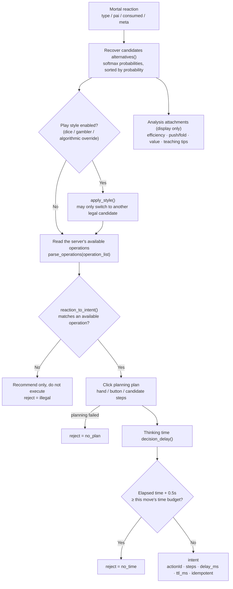

Even when nothing is executed (`reject ≠ null`), the recommendation is still sent to the UI, so Assist mode keeps working.

### 10.2 Legality Validation (`decision/validate.py`)

- `parse_operations()` translates the server's `operation_list` into `LegalActions`: whether a discard is possible, which tiles may be used for the riichi declaration (`liqi_tiles`), the chi / pon / kan combinations, and whether tsumo / ron / nine-terminals abortive draw is possible.
- `reaction_to_intent()` maps the MJAI reaction to the server's operation type (`protocol/optype.py`):

  | Operation | type | Operation | type |
  |---|---|---|---|
  | Discard DAPAI | 1 | Added kan ADD_GANG | 6 |
  | Chi CHI | 2 | Riichi LIQI | 7 |
  | Pon PENG | 3 | Tsumo ZIMO | 8 |
  | Concealed kan AN_GANG | 4 | Ron RONG | 9 |
  | Open kan MING_GANG | 5 | Nine terminals JIUZHONG | 10 |

- Anything that does not match (tile not in hand, combination does not exist, the server did not offer this option) → returns `None`, **never throws, never guesses**.
- Riichi: Mortal only says "riichi"; the declaration tile is the one that is **allowed by the server and has the highest candidate probability** (`_pick_riichi_tile`).

### 10.3 Click Planning (`decision/plan.py`)

Planning produces only **abstract steps**, with no pixel coordinates (the shell converts them according to the screen size, see 11.1):

| Step | Meaning |
|---|---|
| `{"t":"hand","index":i,"gap":bool}` | Click the i-th tile of the sorted hand; `gap=true` means the just-drawn tile (with an extra gap on its right) |
| `{"t":"button","slot":k}` | Click operation-button slot k; **slot 0 is always "skip"** |
| `{"t":"candidate","index":i,"count":n,"kan":bool}` | When chi / pon / kan has several combinations, click the i-th of n candidates |

Buttons are arranged from bottom-right to top-left; when several buttons appear at once they are ordered by priority (`PRIORITY`: skip 0, tsumo / ron 1, riichi / open kan 2, pon / concealed kan / added kan 3, chi 4, nine terminals 5). Concealed kan and added kan share a single "kan" button, and their candidates are merged before choosing. For example:

- Discard: `[hand]`
- Riichi: `[button(riichi), hand(declaration tile)]`
- Chi with two possible ways: `[button(chi), candidate(1 / 2)]`
- No call: `[button(0)]`

### 10.4 Thinking Time (`decision/think.py`)

Like a human: fast when confident, slow when hesitant, but **never timing out**.

<p align="center">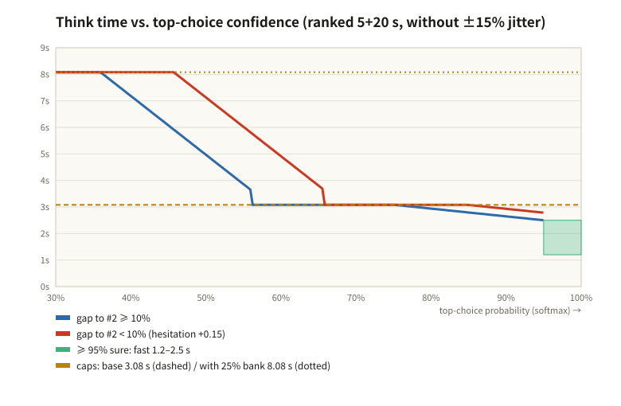</p>

```text
top ≥ 95%                       → random within 1.2–2.5 s
otherwise u = (0.95 − top) / 0.65     (hesitation 0..1)
     gap between top two < 10% → u += 0.15
     target = 2.5 s + u × (4.4 − 2.5) s, then multiplied by a random factor of 0.85–1.15
     u ≥ 0.6 and spare time ≥ 8 s → add a portion of the spare time (at most 25%, and always leave at least 4 s)
cap = time_fixed − 1.5 s (safety margin) − 0.42 s × number of click steps (+ the spare time allowed to be used)
The first discard of a new round waits at least 2 s (the server waits for everyone to be ready; clicking too early is ignored)
```

> The step near 60% in the chart comes from this rule: spare time may only be used once the hesitation u crosses 0.6, and the cap jumps from the base cap to the cap that includes spare time.

The `delay_ms` sent to the shell is `target − time already elapsed` (including inference time); `ttl_ms = this move's time budget − time already used`.

### 10.5 Play Style (optional, `decision/style.py`, `decision/arbiter.py`)

When off, it plays exactly the model's top choice. When on, it may swap to another choice **among the legal candidates the model provided**:

| Style | Rule |
|---|---|
| Dice | Among alternatives whose q value is within 0.61 of the top, pick one at random weighted by $e^{-\Delta q / 0.3}$; if there are none, pick the top choice. Deviates only in "almost equally good" positions |
| Gambler | For each of six yakuman routes (kokushi, suuankou, daisangen, suushii, tsuuiisou, chuuren), compute "how many tiles away from completion"; when the gap is below a threshold that tightens with the turn number, play toward the yakuman |
| Algorithmic override · soft | The model is hesitant (top choice < 60%), the algorithm's preferred candidate got ≥ 15% from the model, and the algorithm's value is higher by 600 points |
| Algorithmic override · hard | Regardless of how confident the model is, when the deal-in loss is lower by ≥ 2500 points and the total value is also higher (candidate probability ≥ 3%) |
| Endgame pass-up | In the last round, if after winning you would still be in last place and the game would end there → do not win, wait for a bigger hand |

Algorithmic value is measured (in points) as attack value − deal-in loss; in the endgame, placement changes are converted into points as `[+15000, +5000, −5000, −20000]`. Style changes are recorded in the recommendation's `style` field, and review still computes the agreement rate against the model's top choice.

---

## 11. Execution Layer: Simulated Clicks and “Stop on Failure”

> 💡 **In plain words**: The shell receives an instruction like "click the 11th tile in the hand", first converts it into a pixel position on screen, and then, like a person: moves over, presses, releases.
> Before every step it re-confirms "is this instruction still valid? Can the window still be clicked?". After clicking, the brain must see with its own eyes that the game sent the corresponding operation for it to count.

### 11.1 The 16×9 Coordinate System (`shared/ui-map.ts`)

The game screen is **kept strictly 16:9**, so every position can be expressed in coordinates whose unit is "screen width / 16", independent of window size. The coordinates come from MahjongCopilot's (GPL-3.0) Positions:

<p align="center">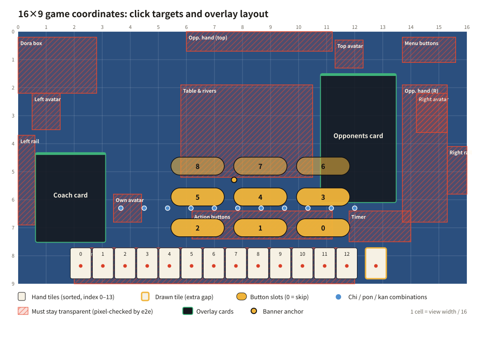</p>

```ts
toView(gx, gy, rect) = { x: rect.x + gx / 16 * rect.w, y: rect.y + gy / 9 * rect.h }
```

- Hand tile centers `TEHAI_X[0..13]`, `TEHAI_Y = 8.3625`; the just-drawn tile is further to the right by `TRUMO_SPACE = 0.246875`.
- 9 button slots, 11 chi/pon candidate positions, 7 kan candidate positions.
- A slot out of range → `SlotOutOfRange`; the whole execution fails rather than clicking somewhere else.
- `UI_MAP_VERSION` records which game version the coordinates correspond to; after a game update, adjust this one file.

### 11.2 ClickExecutor (`src/main/click-executor.ts`)

```text
Wait preDelayMs (= delay_ms, and no more than ttl − 0.42 s × steps − 1 s)
For each step:
  ① Is the intent still the current one? Is the window not minimized / destroyed?   No → abort (aborted)
  ② Convert coordinates (out of range → fail)
  ③ Before the first step, notify Core: action.begin
  ④ mouseMove → wait 60 ms → check ① again → mouseDown → hold 80 ms → mouseUp
  ⑤ Wait 250 ms between steps
All done → action.result ok
```

Two click backends (setting `clickBackend`):

| Backend | Method | Characteristics |
|---|---|---|
| `cdp` (default) | `Input.dispatchMouseEvent` | Can click even when the window is unfocused or on another desktop (macOS Space) |
| `sendInputEvent` | Electron's `webContents.sendInputEvent` | Alternative |

"Whether it can be clicked" looks only at **minimized / destroyed** (`windowCanClick`). `isVisible()` must not be used: on macOS it also returns false when the window is occluded or on another desktop.

### 11.3 The Life of an intent (`core/session.py`)

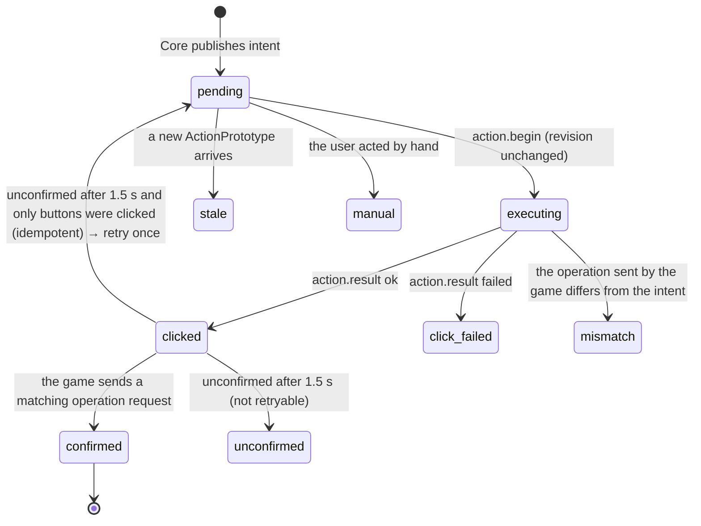

- **Confirmation by observation**: `_observe_out()` sees an outgoing `inputOperation / inputChiPengGang` and compares the operation type (for "no call" it looks at `cancel_operation`).
- **Idempotent retry**: a single retry is allowed only when all steps are buttons (`idempotent`); hand-tile clicks are not retried, to avoid discarding twice.
- **Manual user operation**: seeing an operation request while nothing is being executed → the current intent is cancelled (`manual`), handing control back to the human.

### 11.4 Pause and Automatic Recovery

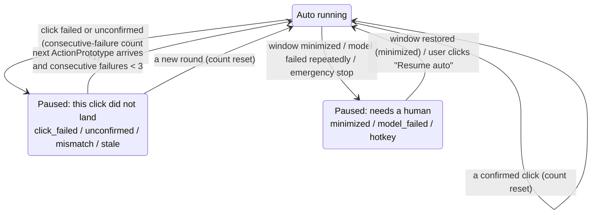

- `MAX_AUTO_RECOVER = 3`: 3 consecutive failures with no confirmed click in between means the click positions or the environment have a problem; it stops and waits for the next round or for the user, to avoid clicking around aimlessly.
- Emergency stop: global hotkey `Ctrl/Cmd+Shift+Space` → immediately back to Assist mode.
- When switching to auto (or resuming), if there is currently a decision that has not been executed yet and the remaining time is ≥ 1.8 s, it takes over immediately (`_takeover`), without waiting for the next turn.

---

## 12. Analysis Modules: Efficiency, Defense, Value, Push/Fold

> 💡 **In plain words**: Besides the AI's advice, the brain also uses traditional mahjong knowledge to work out the "why": which discard gets closest to tenpai, which tile is dangerous against whom,
> how much the tenpai hand is worth, and whether to attack or defend now. These are **for display and teaching only** and do not change the AI's choice (unless you enable algorithmic override).

| Module | Input | Output |
|---|---|---|
| `analysis/efficiency.py` | 34-dimensional counts | Shanten (standard / chiitoitsu / kokushi), waits, ukeire, estimated win rate |
| `analysis/groups.py` | Hand | Splits into sequence / triplet / pair (head) / ryanmen / kanchan / penchan / pair / isolated tile, and marks each taatsu's waits and remaining tiles |
| `analysis/defense.py` | Discards, melds, riichi, dora | Threat level per opponent, combined deal-in rate and 0–4 danger level for each tile, reason codes |
| `analysis/value.py` | Tenpai shape | Han / fu / points for each wait tile: ron / tsumo / ron after riichi (`mahjong` library) |
| `analysis/attack.py` | Position | Win rate, average value and expected value of dama vs riichi; push/fold red-green bar (gain vs loss) |
| `analysis/board.py` | All of the above | Efficiency comparison of candidate discards, attack / neutral / fold verdict |
| `analysis/teach.py`, `knowledge.py` | All of the above | 1–3 structured "whys" and rule knowledge points (rendered by the UI per language) |

### 12.1 Shanten

For the standard form, the four suits are combined from "the Pareto-optimal set of (melds, taatsu) each numbered suit can be split into" (numbered suits are memoized; honors are computed separately),
`shanten = 8 − 2 × melds − taatsu` (taatsu count is capped at 4 − melds), then every possible pair (head) is enumerated and the minimum after −1 is taken; for a closed hand, chiitoitsu `6 − pairs + max(0, 7 − kinds)` and kokushi `13 − terminal/honor kinds − (has a terminal/honor pair ? 1 : 0)` are also computed, and the minimum of the three is taken.

### 12.2 Deal-in Rate (`defense.py`)

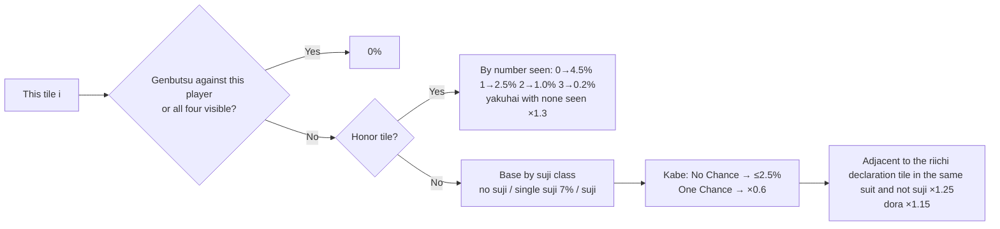

| Number | 1 | 2 | 3 | 4 | 5 | 6 | 7 | 8 | 9 |
|---|---|---|---|---|---|---|---|---|---|
| No suji % | 6.5 | 8.0 | 10.0 | 12.0 | 13.0 | 12.0 | 10.0 | 8.0 | 6.5 |
| Suji % | 1.8 | 3.0 | 4.5 | 3.5 | 3.5 | 3.5 | 4.5 | 3.0 | 1.8 |

This is the deal-in rate against an opponent who **is already tenpai**. For an opponent who has not declared riichi it is multiplied by a **threat** value (≈ probability of being tenpai): riichi 1.0; 3 melds 0.75, 2 melds 0.45, 1 meld 0.2; closed hand `min(0.3, 0.05 + 0.02 × turn)`; +0.15 if the melds contain a yakuhai triplet or dora; +0.1 for 3 consecutive tedashi (discards from the hand) after turn 9; capped at 0.95.

Combined deal-in rate (against all opponents):

$$\text{risk}_i = 1 - \prod_{\text{opponent } o} \left(1 - \text{deal\_in}_o(i) \times \text{threat}_o\right)$$

Levels: `0` safe (0%), `1` < 2%, `2` < 5%, `3` < 9%, `4` extremely dangerous.

### 12.3 Push/Fold Verdict (`board.py: verdict`)

| Shanten after discard | Condition | Verdict |
|---|---|---|
| Tenpai | Max threat < 0.5 or this tile's deal-in rate < 3% | Attack |
| Tenpai | Max threat ≥ 0.8 and deal-in rate ≥ 8% | Fold |
| Tenpai | Otherwise | Neutral |
| ≥ 2-shanten | Max threat ≥ 0.8 | Fold |
| 1-shanten | Max threat ≥ 0.8 | Neutral |
| Otherwise | Max threat < 0.5 → Attack, else Neutral | |

Push/fold red-green bar (`attack.py: balance`): win gain = expected value (when tenpai, win rate × (average value + riichi sticks) − riichi stick cost; when not tenpai, estimated from shanten and ukeire and flagged `est`), deal-in loss = Σ opponent deal-in rate × the opponent's estimated value.

---

## 13. UI: Main Window, Sidebar and In-Game Overlay

> 💡 **In plain words**: The game is on the left of the window (always kept at 16:9, never distorted) and the sidebar is on the right. Over the game lies a piece of **transparent glass** (the overlay),
> and all hints are drawn on the glass; mouse clicks pass through the glass straight to the game, and only when the cursor rests on a hint card does the card receive clicks.

### 13.1 Window Layout (`src/main/layout.ts`, `src/shared/layout-fit.ts`)

<p align="center">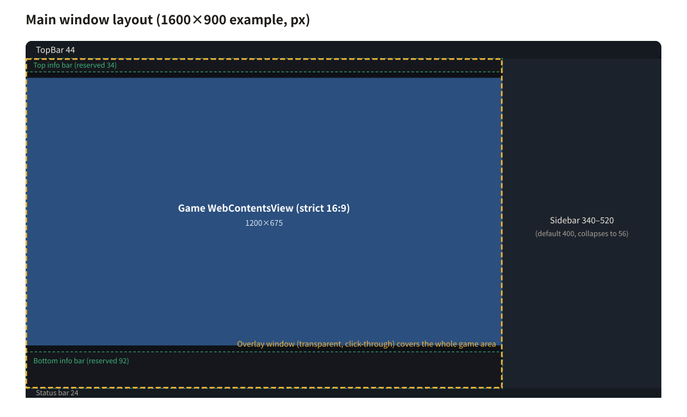</p>

- Game area = the whole region between the top bar (44) and the status bar (24), to the left of the sidebar.
- `fitGame(areaW, areaH, {reserve, dock})`: when "reserve info bars" is on, 34 / 92 px are first set aside at the top and bottom, then a **strictly 16:9** game picture is fitted into the remaining space; any spare space is split evenly top and bottom (`split`) or given entirely to the bottom (`bottom`).
- **The main process uses the same function to place the game view and to lay out the overlay window**, so coordinates inside the overlay always line up with the game picture.
- The sidebar is 340–520 wide (default 400) and can collapse into a 56-wide icon bar.

### 13.2 Renderer Structure

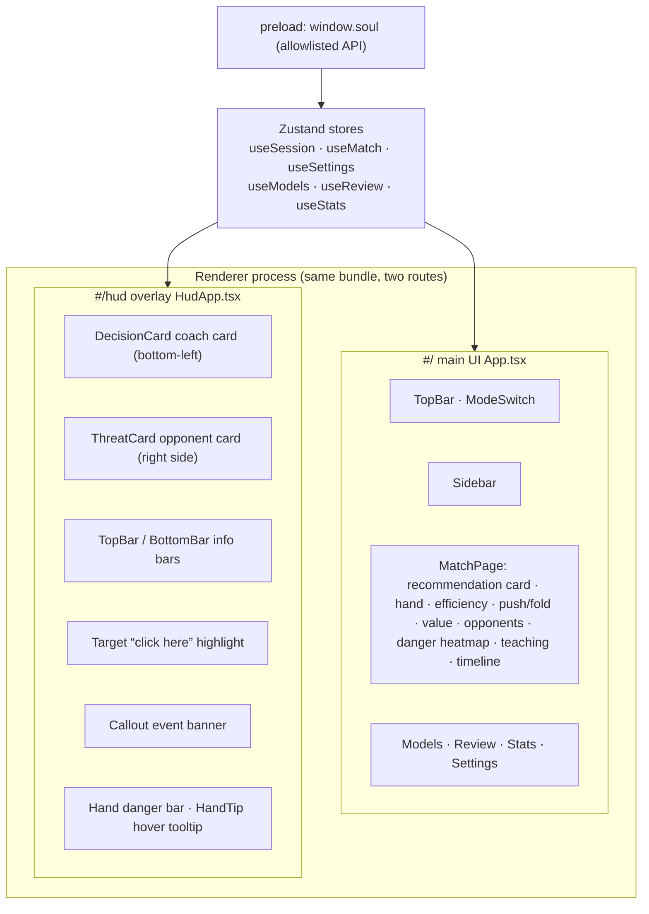

- **One-way data flow**: the main process forwards every Core message to both renderer processes → `applyCoreMessage()` writes it into the Zustand store → components subscribe and render.
- **"Grading" in practice mode happens in the renderer**: when it sees one more tile in our discards, it compares against the recommendation from just before (`judgeDiscard`), accumulating agreement rate, streak, mistakes and value loss.
- The preload exposes only fixed methods (`getSettings / patchSettings / setMode / stopAuto / importModel / …`); the renderer has no Node privileges (`sandbox + contextIsolation`).

### 13.3 Overlay Window (`src/main/overlay.ts`)

| Feature | Implementation |
|---|---|
| Transparent, frameless, does not steal focus | `transparent`, `frame:false`, `focusable:false`, `showInactive()` |
| Click-through by default | `setIgnoreMouseEvents(true, { forward: true })`: clicks pass through, while mouse movement is still forwarded (used for the hand-tile hover tooltip) |
| Cards are interactive | Cursor rests on a card → renderer sends `hud:interactive(true)` → temporarily receives clicks; click-through resumes immediately on leaving |
| Covers the whole game area | `place()` converts the game area (including the top and bottom info bars) into screen coordinates |
| Shown only when needed | Enabled + Assist / Auto mode + in a game + window not minimized |

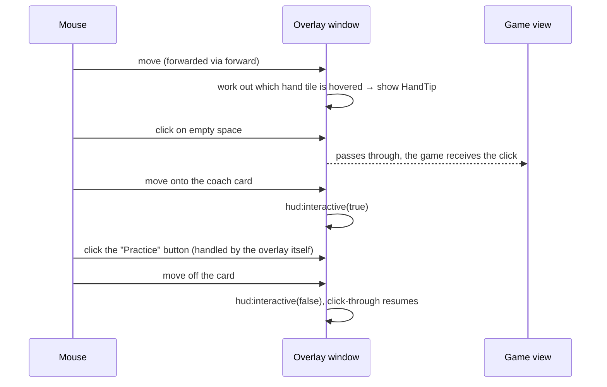

### 13.4 Overlay Layout and "No Occlusion"

The layout (`hud/zones.ts`) is defined in 16×9 coordinates and avoids the key regions measured from real in-game screenshots: the table and discard rivers, operation buttons, the chi/kan candidate row, the countdown, the hand row, the four avatars, the dora frame, the side buttons, and the opponents' hand walls (see the red hatched regions in the coordinate diagram in section 11.1).

`pnpm e2e:hud` renders every scenario into a PNG with an alpha channel and **asserts pixel by pixel that the alpha in these regions is all 0**, and repeats the check under extreme conditions such as 1.1× scaling and shorter windows.

Overlay contents:

| Component | Content |
|---|---|
| Coach card DecisionCard | Recommended tile + large action text + confidence ring, shanten progress (3+ · 2 · 1 · tenpai · win), deal-in rate and push/fold label, one-line reason, candidate comparison table (AI probability / shanten after discard / ukeire / deal-in rate, ◎ = top choice); hover to expand all reasons and this game's mistakes |
| Opponent card ThreatCard | Each player's seat wind (dealer = shu-colored background), placement, point difference, ten-cell tenpai likelihood, riichi stamp, reasons, tiles safe against that player; at the bottom a three-cell Fold · Neutral · Attack verdict |
| Top info bar | Game situation, honba / riichi sticks / remaining tiles / turn, placement badge with differences to the places above and below, All Last notice, the four players' points (a riichi player gets a drawn point stick) |
| Bottom info bar | Hand grouping (sequence / triplet / pair / taatsu with waits and remaining tiles), value of each wait tile when tenpai, melds, push/fold red-green bar |
| Target | Draws a solid frame and a "fuda" tag (the action name) on the tile / button to click; each new recommendation "slaps down" once |
| Callout | Banner that pops up for tenpai, streaks, "try a different idea" (mistake), opponent riichi and placement changes, and disappears after about 2 seconds |
| Danger bar / HandTip | A five-level color bar above each hand tile; hovering shows the reason, efficiency after the discard and the AI probability |

### 13.5 Visual Language “Wa · Takujo”

Flat, solid color blocks, thin dividers, no glow and no gradients. Color carries meaning only (`--wa-*` in `styles/tokens.css`):

| Color | Traditional color name | Meaning |
|---|---|---|
| `#e5492f` | shu (vermilion) | Danger, riichi, mistake |
| `#f0b43a` | yamabuki (gold) | Riichi advice, first place, winning target |
| `#3fb27b` | aotake (green) | Recommended discard, safe, attack |
| `#4f8fd0` | ai (indigo) | Meld, teaching |
| `#e33f62` | beni (crimson) | Win |
| `#15171c` / `#f3eee1` | sumi / kinari | Card background / text (swapped for washi-paper background and ink text in the light theme) |

Animations are brief "tile slap / stamp" effects (200–340 ms, never looping), and all are disabled under `prefers-reduced-motion`.

---

## 14. Auto-Matchmaking: Finding Buttons by Looking at the Screen

> 💡 **In plain words**: After a game ends, the results screen has several pages that need "Confirm" clicks. Every 2.5 seconds the program takes a look at the game screen,
> recognizes color blocks such as "the yellow Confirm button" and "the blue Play Again", and clicks them; once in the next game, it hands over to auto-play.

- **No script injection, no forged messages**: only screenshots (`capturePage`) + color sampling + the same click channel.
- Color detection (BGRA sampling, avoiding the text in the middle of the button): yellow 「確認」 (Confirm) `r>200, g>150, b<150, r−b>95`; blue 「再來一場 / 取消」 (Play Again / Cancel) `b>110, b−r>60, r<95, g<120`; a sample point hit rate ≥ 55% is required.
- Fallback: if "Play Again" does not appear, return to the lobby and click through, per the previous room, Ranked → Bronze / Silver / Gold / Jade / Throne → East / South (for Jade and Throne, scroll the wheel first). The room is remembered from `NotifyMatchGameStart.match_mode_id`.

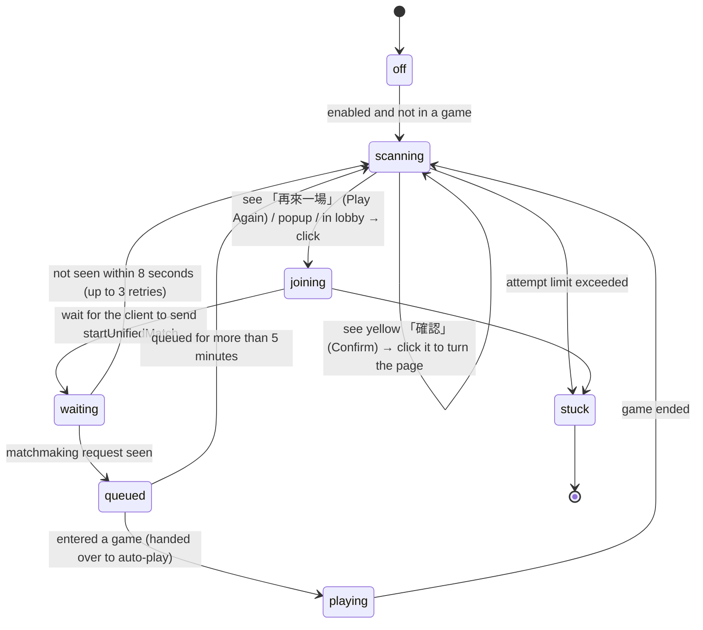

---

## 15. Data, Models and Security Boundaries

### 15.1 Data Directory (`src/main/paths.ts`)

Priority: environment variable `MAJSOUL_BROWSER_DATA_DIR` → `.data/` in the repository in development mode → the directory containing the macOS `.app` → next to the Linux AppImage file → next to the Windows / Linux executable. At startup the subdirectories are created and a **write probe** is performed; if the location is not writable, a dialog explains it, and it never silently moves elsewhere.

```text
MajsoulBrowserData/
├── settings.json        Settings (atomic write: write .tmp first, then rename)
├── profile/             Chromium user data: Mahjong Soul login cookies, cache
├── models/              <sha256>.pth + manifest.json
├── records/             Game records game-*.jsonl, raw frames frames-*.jsonl
├── logs/  tmp/  crash/
```

When run directly from the "Downloads" folder, macOS places the app in a read-only quarantine path (AppTranslocation); the program detects this and prompts you to move it.

### 15.2 Model Import (`core/models.py`)

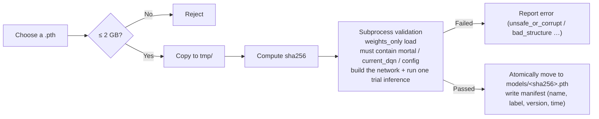

Validation is done in a **subprocess**: even if a faulty model file causes a crash, Core is unaffected.

### 15.3 Game Records (`core/records.py`, `src/main/recorder.ts`)

One JSONL per game: `start` (uuid, seat) → `event` (MJAI events) → `rec` (recommendation with all candidate q values) → `exec` (execution result) → `end`. The review page (`review.py`) uses this to compute, for every move, whether it agreed with the model, the mistakes and the value loss; the stats page aggregates past games. Raw frames can additionally be recorded as material for replay tests (they contain account information and never go into Git).

### 15.4 Security Checklist

| Item | Approach |
|---|---|
| Protocol | Read-only; static check + runtime allowlist |
| Web sandbox | The game view, main UI and overlay all enable `sandbox`, `contextIsolation`, and `nodeIntegration:false` |
| Navigation | The game view allows only Mahjong Soul-related domains; the main UI and overlay forbid any navigation and popups |
| Permissions | Permission requests for camera, microphone, notifications and so on are always denied |
| Model | `weights_only=True`, rejects arbitrary code; subprocess validation |
| Debug interface | In-process CDP, no port opened |
| System | No proxy changes, no certificate installation, nothing written to the user directory |

---

## 16. Internationalization

- Renderer: `renderer/i18n/{zh-CN,en,ja,ko,de}.ts`, with the type `Messages = typeof zhCN`; **every other language must have exactly the same keys**, otherwise `tsc` reports an error.
- Main process: `src/main/i18n.ts` (menus, system dialogs, startup errors); the menu is rebuilt when the language changes.
- On first run the language is chosen from the system locale (`shared/lang.ts: pickLang`), and afterwards follows the setting.
- Core produces no user-facing sentences: teaching tips, knowledge points and pause reasons are all **structured codes** (`{"code":"suji","tile":"5m"}`) that the UI renders per language.
- Glossary (`gloss.*`): terms that appear in UI text are automatically underlined, and hovering shows an explanation.

---

## 17. Build, Packaging and Release

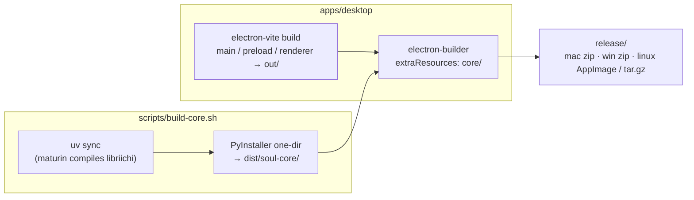

| Target | Command | Notes |
|---|---|---|
| macOS Apple Silicon | `scripts/package.sh mac-arm64` | |
| macOS Intel | `scripts/package.sh mac-x64` | Uses Rosetta 2 on Apple Silicon: a separate x86_64 virtual environment, `CARGO_BUILD_TARGET=x86_64-apple-darwin` |
| Windows x64 | `scripts/package.sh win` | Must be run on Windows (Git Bash) |
| Linux x64 | `scripts/package.sh linux` | Must be run on Linux |

Platform-specific dependencies (`core/pyproject.toml`):

| Platform | torch | numpy | Reason |
|---|---|---|---|
| macOS Intel | 2.2.2 | 1.26 | PyTorch stopped providing macOS x86_64 wheels after 2.2, and 2.2 is only compatible with numpy 1.x |
| Linux | `+cpu` (PyTorch's official CPU index) | ≥ 2 | The PyPI default bundles CUDA (several GB) |
| macOS arm64 / Windows | PyPI default (CPU) | ≥ 2 | |

At runtime: the packaged Core is `resources/core/soul-core(.exe)`; the same executable acts as the inference subprocess (`soul-core runner`) and the model tool (`soul-core models`) through subcommands. In development, the Python of `core/.venv` runs `-m soul_core.main`.

App icon: `apps/desktop/scripts/make-icon.cjs` renders an SVG in offscreen Electron to produce `build/icon.png` (for installers) and `resources/icon.png` (dock / window icon in development). Run `pnpm icon` (needs the Songti font that ships with macOS).

GitHub Actions:

- `ci.yml`: on every push, runs the Core tests, frontend type check and tests, and the read-only check on macOS / Windows / Linux.
- `release.yml`: triggered manually, packages on four native environments and uploads Artifacts; when `draft` is ticked it creates a **draft** Release, which is never published automatically.

---

## 18. Test Suite

| Layer | Command | Coverage |
|---|---|---|
| Core unit / integration | `uv run pytest` | Protocol decoding, state machine (synthetic games and real capture replays), legality mapping, click planning, thinking time, style and override, efficiency / defense / value, review statistics, stdio protocol, stop on failure; tests that need a model are skipped automatically when no model is present |
| Frontend unit | `pnpm test` (vitest) | Click coordinates, layout, CoreClient supervision (real subprocess), auto-matchmaking state machine and color detection, practice grading, event banners, glossary tokenization, language selection, data directory |
| Types | `pnpm typecheck` | Includes key consistency across the five languages |
| Click end-to-end | `pnpm e2e:click` | Real mouse events hit a fake Canvas page, checking coordinates, unfocused windows, and zero duplicate clicks |
| Overlay end-to-end | `pnpm e2e:hud` | Pixel-by-pixel check that key regions are not occluded |
| Layout end-to-end | `pnpm e2e:layout` | Sidebar scrolls at the minimum window size |
| Visual | `pnpm design:shots` / `design:hud` | Screenshots of every state, checked manually |
| Read-only | `scripts/verify-readonly.sh` | Static check |
| Smoke | `SOUL_SMOKE_SECONDS=20 ./Majsoul-Browser` | After the packaged build starts, outputs Core status, frame count and whether the overlay is ready |

---

## 19. Roadmap for Rebuilding from Scratch

To reimplement from an empty directory, follow the order below; every step can be verified independently:

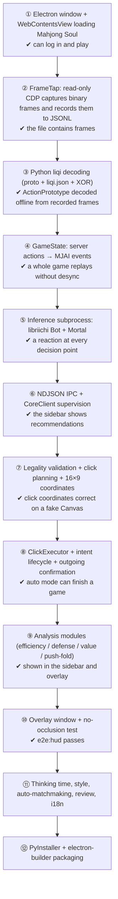

A few easy pitfalls:

1. **CDP startup order**: `about:blank` first, then attach, then navigate (section 5.1).
2. **Focus**: without focus emulation, clicks have no effect after switching to another application.
3. **Background throttling**: if you do not turn off Chromium's background throttling, the game freezes when the window is occluded.
4. **Hand order**: clicks use the client's display order (red five before the plain five), not the server's array order.
5. **Riichi declaration**: Mortal only gives "riichi"; the declaration tile must be chosen separately from the tiles the server allows.
6. **Confirmation**: clicking does not mean success; you must see the operation request sent by the game.
7. **Windows pipes**: `select()` cannot wait on pipes, use a reader thread.
8. **macOS visibility**: `isVisible()` is false when the window is occluded / on another desktop, so it cannot be used to decide whether clicking is possible.

---

## 20. Known Limitations and Extension Points

| Limitation | Notes |
|---|---|
| Four-player mahjong only | 3-player games enter `unsupported_mode` and all features are turned off |
| Coordinates depend on the game version | After a game update, `shared/ui-map.ts` and `hud/zones.ts` may need updating |
| Analysis is approximate | Deal-in rates, threat levels and expected values are empirical estimates, meant for teaching and ranking |
| No model included | Users must bring their own Mortal-format model |
| Unsigned | macOS / Windows show system warnings on first launch |
| A few Core messages are still in Chinese | Some error messages (`hint`) come from Core and have not been structured yet |

Extension points:

- **A new click target**: add coordinates in `ui-map.ts`, and add a step type in `plan.py`.
- **A new analysis**: add a pure function in `analysis/`, hook it into `decide.py: _attach_insight`, and add the types to `protocol.ts` on the frontend.
- **A new teaching tip**: `teach.py` emits a new `code`, and the `tips.*` text is added in all five languages.
- **A new language**: copy `en.ts` and translate it, then register it in `shared/lang.ts` and `main/i18n.ts`.
- **Swapping the AI**: any inference subprocess works as long as it follows the convention "one MJAI event per line in → one reaction per line out (including `meta.q_values / mask_bits`)".

---

<sub>Diagrams: Mermaid diagrams are rendered directly by GitHub; `images/diagrams/*.svg` are generated from source-code constants by `images/diagrams/gen_svg.py`; re-run it after changing the relevant constants.</sub>
