# 雀魂浏览器 Majsoul-Browser · 技术文档

**简体中文** · [English](TECHNICAL.en.md)

> 这份文档的目标：**只看文档就能把整个项目重新做出来**。
> 每一章都分两层：开头的「💡 通俗地说」给完全不懂编程的读者，后面的细节给工程师。
> 所有数字、阈值、常量都直接取自源码，文中会注明出处（`文件:函数`），方便对照。

<p align="center"></p>

## 目录

1. [一分钟看懂](#1-一分钟看懂)
2. [名词速查](#2-名词速查)
3. [总体架构](#3-总体架构)
4. [一手牌的完整旅程](#4-一手牌的完整旅程)
5. [数据采集：只读地“偷听”游戏](#5-数据采集只读地偷听游戏)
6. [进程间通信：Electron ⇄ Core](#6-进程间通信electron--core)
7. [协议解码：把二进制帧变成可读消息](#7-协议解码把二进制帧变成可读消息)
8. [牌局状态机：唯一的事实来源](#8-牌局状态机唯一的事实来源)
9. [AI 推理：Mortal 与推理子进程](#9-ai-推理mortal-与推理子进程)
10. [决策层：从“模型想打什么”到“该点哪里”](#10-决策层从模型想打什么到该点哪里)
11. [执行层：模拟点击与“失败即停”](#11-执行层模拟点击与失败即停)
12. [分析模块：牌效、防守、打点、押引](#12-分析模块牌效防守打点押引)
13. [界面：主窗口、侧栏与游戏内信息层](#13-界面主窗口侧栏与游戏内信息层)
14. [自动匹配：看画面找按钮](#14-自动匹配看画面找按钮)
15. [数据、模型与安全边界](#15-数据模型与安全边界)
16. [多语言](#16-多语言)
17. [构建、打包与发布](#17-构建打包与发布)
18. [测试体系](#18-测试体系)
19. [从零复刻路线图](#19-从零复刻路线图)
20. [已知限制与扩展点](#20-已知限制与扩展点)

---

## 1. 一分钟看懂

> 💡 **通俗地说**：雀魂浏览器是一个“自带副驾驶的浏览器”。你在里面正常打雀魂，它在旁边**只听不说**地读取牌局，
> 把局面交给装在你电脑上的麻将 AI（Mortal），然后把 AI 的建议画在游戏画面上。
> 打开自动模式后，它会像人一样移动鼠标去点击，并且在任何没把握的时候主动停下来。

它由三件东西组成：

| 部分 | 用什么写 | 做什么 |
|---|---|---|
| **桌面外壳**（apps/desktop） | Electron + React + TypeScript | 显示雀魂网页、读取网络消息、画界面和信息层、模拟鼠标点击 |
| **大脑**（core） | Python 3.12 | 解码协议、维护牌局状态、调用 AI、计算牌效 / 危险度 / 打点、决定点哪里 |
| **AI 模型**（用户自备） | PyTorch 模型文件 `.pth` | Mortal 四麻模型，输入牌局事件，输出每个动作的评分 |

三条不可妥协的原则（贯穿整个设计）：

1. **零协议写入**：绝不向服务器发送、修改或丢弃任何数据，所有操作只靠模拟鼠标。
2. **零系统改动**：不改代理、不装证书、不要管理员权限，数据只写在程序旁边。
3. **失败即停**：任何不确定（牌局对不上、模型异常、点击没被确认）都停止自动操作，绝不“猜着点”。

---

## 2. 名词速查

<details open>
<summary><b>麻将术语</b></summary>

| 术语 | 含义 |
|---|---|
| 四麻 / 日麻 | 四人立直麻将（本项目只支持四人） |
| 向听（Shanten） | 离听牌还差几步；0 = 听牌，-1 = 已和 |
| 听牌（Tenpai） | 再来一张对的牌就能和 |
| 进张（Ukeire） | 能让向听数减少的牌，以及场上还剩几张 |
| 立直（Riichi） | 门清听牌时宣言，之后不能换牌 |
| 鸣牌 | 吃 / 碰 / 杠 别人打出的牌 |
| 放铳（Deal-in） | 打出的牌被别人荣和 |
| 现物 / 筋 / 壁 | 判断一张牌对某家是否安全的经典方法 |
| 押引（Push / Fold） | 继续进攻还是放弃和牌转为防守 |
| 番 / 符 / 役 | 计算打点（分数）用的规则 |
| 振听 | 自己打过的牌不能荣和 |

</details>

<details open>
<summary><b>技术术语</b></summary>

| 术语 | 含义 |
|---|---|
| Electron | 用网页技术写桌面程序的框架，自带一个 Chromium 浏览器 |
| 主进程 / 渲染进程 | Electron 的“后台管理员”和“显示网页的进程” |
| WebContentsView | Electron 里一块可以加载网页的区域（这里用来放雀魂） |
| CDP | Chrome DevTools Protocol，浏览器调试接口；这里只用来**读**网络消息和发鼠标事件 |
| WebSocket 帧 | 游戏与服务器之间的一条消息 |
| Protobuf | 谷歌的二进制数据格式，雀魂用它编码消息 |
| NDJSON | 每行一个 JSON，用来在两个进程之间传消息 |
| MJAI | 麻将 AI 通用的事件格式（`{"type":"dahai","pai":"5m",…}`） |
| Mortal | 开源的深度强化学习麻将 AI |
| libriichi | Mortal 的 Rust 核心库，负责规则与特征编码 |
| PyInstaller | 把 Python 程序打包成不需要安装 Python 的可执行文件 |
| intent | 本项目的术语：一次“要执行的操作”，带编号、步骤和有效期 |
| revision | 本项目的术语：牌局状态的版本号，每条消息 +1，用来判断推荐是否过期 |

</details>

---

## 3. 总体架构

> 💡 **通俗地说**：程序启动后会同时跑好几个“小程序”（进程），各管一摊：一个显示网页，一个画界面，
> 一个透明地盖在游戏上面画提示，一个 Python 大脑，大脑里还会再开一个专门跑 AI 的子进程。
> 它们之间通过“传纸条”（消息）合作，任何一个出问题都不会拖垮别人。

### 3.1 进程全景

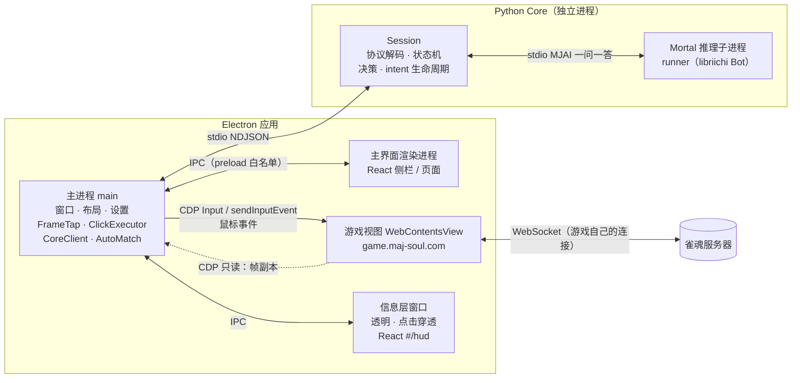

| 进程 | 入口 | 职责 | 崩溃后 |
|---|---|---|---|
| 主进程 | `apps/desktop/src/main/index.ts` | 创建窗口、摆布局、读帧、转发消息、执行点击、监督 Core | 应用退出 |
| 主界面渲染进程 | `src/renderer/main.tsx` → `App.tsx` | 侧栏、模型 / 复盘 / 统计 / 设置页面 | 可重新加载 |
| 游戏视图 | `WebContentsView`，分区 `persist:majsoul` | 原样运行雀魂网页 | 用户可重新加载 |
| 信息层窗口 | 同一个渲染包的 `#/hud` 路由 | 画在游戏画面上的提示 | 重新加载后回放缓存的最新状态 |
| Core | `core/src/soul_core/main.py` | 解码、状态机、决策、分析 | **指数退避自动重启**，回放会话命令 |
| 推理子进程 | `soul_core/inference/runner.py` | 加载模型、对每个事件给出反应 | 本局失步，下一局自动重建 |

### 3.2 技术栈

| 层 | 选型 | 为什么 |
|---|---|---|
| 桌面框架 | Electron 45 | 内置 Chromium，可以原样运行雀魂网页版；`webContents.debugger` 提供进程内 CDP，不用开调试端口 |
| 构建 | electron-vite + Vite + TypeScript 7 | main / preload / renderer 三个包一次构建 |
| UI | React 19 + CSS Modules + Zustand | 组件化；Zustand 小而够用 |
| 国际化 | i18next | 五种语言，类型约束保证每种语言键完全一致 |
| 大脑 | Python 3.12（uv 管理） | Mortal 是 PyTorch 模型，Python 生态最自然 |
| AI | Mortal（PyTorch）+ libriichi（Rust，PyO3） | 开源最强之一的日麻 AI |
| 打点 | `mahjong` 库 | 计算役、番、符、点数 |
| 打包 | PyInstaller（Core）+ electron-builder（外壳） | 用户不需要安装 Python / Node |

### 3.3 目录结构

```
majsoul-browser/
├── apps/desktop/                 Electron 应用
│   ├── src/main/                 主进程：index.ts（总装）、frame-tap、core-client、click-executor、
│   │                             overlay、layout、auto-match、settings、paths、models、recorder、i18n
│   ├── src/preload/              暴露给渲染层的白名单 API（window.soul）
│   ├── src/renderer/             React：features/（页面与卡片）、hud/（游戏内信息层）、stores/、i18n/
│   ├── src/shared/               主进程与渲染层共用：protocol（消息类型）、ui-map（点击坐标）、
│   │                             layout-fit（16:9 排版）、overlay-shapes、lang
│   ├── resources/                牌面 SVG、字体、图标
│   └── scripts/                  端到端测试、截图、图标生成
├── core/src/soul_core/           Python Core
│   ├── main.py / ipc.py          NDJSON 入口
│   ├── session.py                会话：把下面所有模块串起来
│   ├── protocol/                 liqi 协议解码（只读）、proto 定义
│   ├── game/                     牌局状态机、手牌、牌名
│   ├── inference/                模型结构、引擎、推理子进程与客户端
│   ├── decision/                 动作空间、合法性校验、点击规划、思考时间、打牌风格、算法改判
│   ├── analysis/                 牌效、分组、防守、打点、押引、教学提示、知识点
│   ├── models.py                 模型导入与校验
│   ├── records.py / review.py    对局记录、复盘与统计
├── vendor/mortal/                Mortal 源码（AGPL-3.0），用于编译 libriichi
├── scripts/                      打包、只读检查、SBOM
└── .github/workflows/            CI 与发布
```

---

## 4. 一手牌的完整旅程

> 💡 **通俗地说**：服务器告诉游戏“你摸到了一张 5 万，可以打牌了”。这条消息被复制一份给大脑；
> 大脑更新牌局、问 AI，AI 说“打 9 索”；大脑算出“9 索在手牌第 11 张”，再按 AI 的犹豫程度等一会儿，
> 然后让外壳把鼠标移过去点一下；最后大脑看到游戏真的发出了“打 9 索”的请求，才算完成。

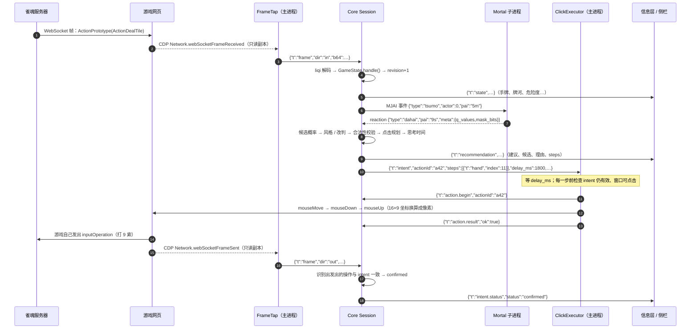

关键点：

- **谁也不替游戏说话**：第 14 步的请求是游戏网页**自己**因为收到鼠标点击而发出的。项目只“看到”它，用来确认点击生效。
- **revision 防过期**：第 4 步 revision +1；如果推理期间又来了新消息（别人鸣牌等），第 9 步发布前发现 revision 变了就丢弃这次推荐。
- **每一层都能否决**：模型反应不合法、规划不出点击、时间不够、窗口被最小化、intent 被新消息作废……任何一项都会让这一步不执行。

---

## 5. 数据采集：只读地“偷听”游戏

> 💡 **通俗地说**：浏览器自带一个给开发者用的“监听器”。我们只打开它的“网络监听”功能，
> 拿到游戏收发的每条消息的**复印件**，原件照常送达，不改一个字。

### 5.1 FrameTap（`src/main/frame-tap.ts`）

- 通过 `webContents.debugger.attach('1.3')` 使用**进程内** CDP，不打开任何调试端口，外部程序无法连接。
- **方法白名单**：`cdp()` 只允许下面几个方法，其它一律抛错：

  | 用途 | 允许的 CDP 方法 |
  |---|---|
  | 读网络 | `Network.enable`、`Target.setAutoAttach` |
  | 点击（备选后端） | `Input.dispatchMouseEvent` |
  | 焦点模拟 | `Emulation.setFocusEmulationEnabled` |

- 监听 `Network.webSocketFrameReceived / Sent`，**只转发二进制帧**（`opcode === 2`），连接 id = `sessionId:requestId`。
- `Target.setAutoAttach({flatten:true})`：如果 WebSocket 开在 Worker / iframe 里，也能自动附加子目标并对它开启 `Network.enable`。

**启动顺序（实测结论）**：渲染进程还没创建时调用 `Network.enable` 会一直挂起，所以必须：

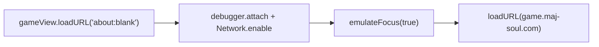

**焦点模拟**：切到别的软件后，Unity 版雀魂认为自己没有焦点，就不处理输入，点击会“点不动”。
`Emulation.setFocusEmulationEnabled(true)` 让页面始终认为有焦点；每次页面加载完成都会重新设置。

### 5.2 只读守护

| 防线 | 位置 | 内容 |
|---|---|---|
| 运行时白名单 | `frame-tap.ts` | 只允许上表的 CDP 方法 |
| 静态检查 | `scripts/verify-readonly.sh`（CI 必跑） | 用 ripgrep 搜索 `Fetch.`、`Runtime.evaluate`、`setRequestInterception`、`.send(…WebSocket` 等字样；`inputOperation` 只能出现在只读解析代码和测试里 |
| 协议层 | `core/protocol/outgoing.py` | 只**识别**客户端发出的操作请求，绝不构造 |
| 导航白名单 | `navigation-policy.ts` | 游戏视图只能导航到 `maj-soul.com / majsoul.com / mahjongsoul.com / yo-star.com / catfood.com` 的 https；权限请求一律拒绝 |

### 5.3 后台运行

切到别的软件或窗口被遮挡时，Chromium 默认会降低后台页面的帧率与计时器精度，游戏画面会停住。启动参数关闭了这些优化：

```ts
app.commandLine.appendSwitch('disable-renderer-backgrounding')
app.commandLine.appendSwitch('disable-background-timer-throttling')
app.commandLine.appendSwitch('disable-backgrounding-occluded-windows')
// 游戏视图与信息层：webPreferences.backgroundThrottling = false
```

---

## 6. 进程间通信：Electron ⇄ Core

> 💡 **通俗地说**：外壳和大脑是两个独立程序，靠“一行一张纸条”的方式对话：外壳往大脑的输入里写一行 JSON，
> 大脑往输出里回一行 JSON。大脑如果意外退出，外壳会过一会儿把它重新叫起来，并把“当前设置”再告诉它一遍。

### 6.1 传输格式

- **NDJSON over stdio**：stdin 命令、stdout 事件、stderr 日志（`core/ipc.py: Emitter` 带锁，多线程写也不会交错）。
- 消息类型手写在 `apps/desktop/src/shared/protocol.ts`，两端共用同一份契约（Core 的测试用 JSON fixture 对照）。
- **版本握手**：Core 启动先发 `{"t":"ready","protocolVersion":1}`；版本不同 → 主进程弹窗并停止，不会“半兼容”地运行。

### 6.2 消息一览

| 方向 | 消息 | 作用 |
|---|---|---|
| → Core | `hello` | 握手，携带协议版本 |
| → Core | `ws.open` / `ws.close` / `frame` | WebSocket 连接与帧（base64） |
| → Core | `mode.set` | 关 / 辅助 / 自动 |
| → Core | `auto.pause` / `auto.resume` | 暂停（最小化等）/ 继续 |
| → Core | `model.activate` | 切换模型（对局中只登记，下一局生效） |
| → Core | `action.begin` / `action.result` | 点击开始 / 结果 |
| → Core | `config` | 记录目录、是否记录、打牌风格开关 |
| → Core | `review.list` / `review.get` / `stats.get` | 复盘与统计 |
| ← Core | `ready` | 就绪 + 版本 |
| ← Core | `state` | 牌局快照（手牌、牌河、副露、点数、分析） |
| ← Core | `recommendation` | 推荐、候选、牌效、押引、教学提示、点击步骤 |
| ← Core | `intent` / `intent.status` | 要执行的操作 / 它的结局 |
| ← Core | `session.status` | 阶段、模式、暂停原因、模型状态 |
| ← Core | `model.status` / `error` / `log` | 模型、错误、日志 |
| ← Core | `lobby.match` / `lobby.matched` / `game.end` | 自动匹配用的大厅事件 |

### 6.3 监督与重启（`src/main/core-client.ts`）

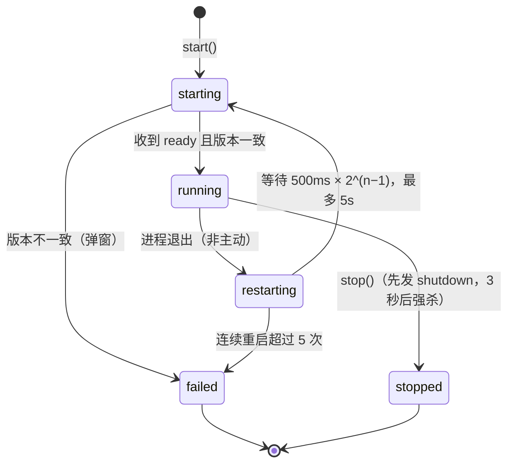

- **粘性命令**：`config`、`mode.set`、`model.activate` 会被记住，Core 每次重新 ready 后自动重发，所以重启对用户几乎无感。
- 信息层窗口重新加载时，主进程会回放缓存的最新 `state / recommendation / session.status / model.status`（`hudCache`）。

---

## 7. 协议解码：把二进制帧变成可读消息

> 💡 **通俗地说**：游戏的消息是压缩过的二进制“密文”。我们按照公开的格式说明（proto 定义）把它还原成
> “某某动作、某某数据”的结构，其中有一部分还做了简单的异或混淆，也一并还原。

### 7.1 帧格式（`core/protocol/liqi.py`）

<p align="center">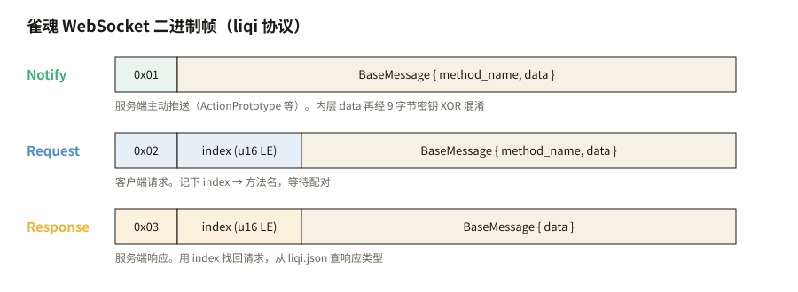</p>

- 第 1 字节是类型：`1 Notify`（服务器推送）、`2 Request`（客户端请求）、`3 Response`（服务器响应）。
- 请求 / 响应带 2 字节小端 `index`，每个连接各自维护 `index → (方法名, 响应类型)`，收到响应时配对弹出；重复 index 或无主响应视为异常。
- 消息体是 protobuf `BaseMessage`；方法名 → 请求 / 响应类型查 `protocol/data/liqi.json`。
- Notify 里的 `ActionPrototype` 还有一层：`data` 字段 base64 解码后做 XOR：

  ```python
  keys = [0x84, 0x5E, 0x4E, 0x42, 0x39, 0xA2, 0x1F, 0x60, 0x1C]
  for i, byte in enumerate(buf):
      u = ((23 ^ len(buf)) + 5 * i + keys[i % 9]) & 0xFF
      buf[i] = byte ^ u
  ```

### 7.2 Core 关心的消息（`protocol/sync.py: METHODS`）

| 方法 | 含义 |
|---|---|
| `.lq.Lobby.login` / `oauth2Login` | 记下自己的账号 id（用于确定座位） |
| `.lq.FastTest.authGame` | 进入对局：座位、规则、玩家 |
| `.lq.FastTest.syncGame` | 断线重连：把已经发生的动作整体重放（明文，不做 XOR） |
| `.lq.ActionPrototype` | 对局中每一个动作（摸牌、打牌、鸣牌、和牌、流局、新一局…） |
| `.lq.NotifyGameEndResult` / `NotifyGameTerminate` | 对局结束 |
| `.lq.FastTest.inputOperation` / `inputChiPengGang`（出方向） | 客户端发出的操作，**只用于确认点击与识别手动操作** |
| `.lq.Lobby.startUnifiedMatch`（出方向）/ `NotifyMatchGameStart` | 自动匹配用：开始排队 / 匹配成功 |

---

## 8. 牌局状态机：唯一的事实来源

> 💡 **通俗地说**：大脑里有一张“记分板”，记着每个人的手牌、牌河、鸣牌、立直、点数。它**只相信**服务器发来的消息，
> 每收到一条就更新一次。一旦发现对不上（比如要打的牌不在手里），就把记分板标成“失步”，在下一局开始前不再给任何建议。

### 8.1 职责（`core/game/state.py: GameState`）

- **纯函数式**：输入 `(method, name, data)`，输出 `Output`；不做任何 I/O，便于用录好的帧回放测试。
- 维护：自家座位、手牌（**按服务端顺序**保存，见 8.3）、摸牌、四家牌河（每张带全局序号 `seq`）、副露、立直 / 一发、宝牌指示牌、点数、本场 / 供托、剩余牌数、振听、当前可选操作（`operation`）。
- 把服务器动作翻译成 **MJAI 事件**喂给 Mortal：

| 服务器动作 | 产出的 MJAI 事件 |
|---|---|
| `authGame`（四人） | 以自家座位重建推理子进程 + `start_game` |
| `ActionNewRound` | `start_kyoku`（场风、局数、本场、供托、宝牌、亲家、点数、自家配牌） |
| `ActionDealTile` | `tsumo`（别人的摸牌是 `?`）；新宝牌 → `dora` |
| `ActionDiscardTile` | 立直宣言 → `reach`；`dahai`；下一条动作不是荣和时 → `reach_accepted` |
| `ActionChiPengGang` | `chi` / `pon` / `daiminkan`（含 consumed） |
| `ActionAnGangAddGang` | `ankan` / `kakan` |
| `ActionHule` | `hora` → `end_kyoku` |
| `ActionNoTile` / `ActionLiuJu` | `ryukyoku` → `end_kyoku` |
| `NotifyGameEndResult` | `end_game`，释放推理子进程 |

`Output` 结构：`events`（依次喂给模型）、`decide_from`（只有从这个下标开始的事件产生的反应才算决策点，重连重放时前面的都不算）、`restart_seat`（需要以该座位重建子进程）、`stop_worker`、`fresh_round`（新一局第一打要多等一会儿）。

### 8.2 阶段与失步

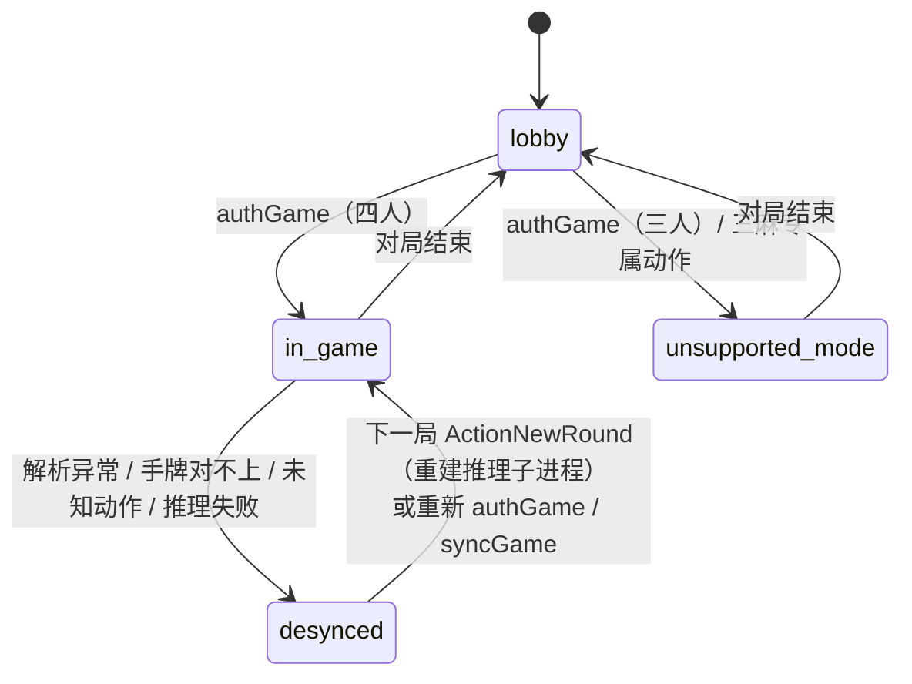

- `handle()` 外层 `try/except`：**任何异常都只会变成失步，绝不让 Core 崩溃**。
- 失步时：取消当前 intent（`desync`）、不再喂事件、不出推荐；界面显示原因。
- `revision`：每条消息 +1。推荐、intent 都带着它，发布 / 执行前对比，过期就丢弃。

### 8.3 三套牌名（`game/tiles.py`、`game/hand_tracker.py`）

| 写法 | 万 / 筒 / 索 | 赤五 | 字牌 |
|---|---|---|---|
| 服务端 | `1m…9m` / `1p…` / `1s…` | `0m` `0p` `0s` | `1z…7z` |
| MJAI | 同上 | `5mr` `5pr` `5sr` | `E S W N P F C` |
| 展示 | 一万… | 赤五万 | 东 南 西 北 白 发 中 |

客户端手牌显示顺序是 **万 → 筒 → 索 → 字**，同数字时**赤五排在普通五前面**；点击手牌第几张，依赖的正是这个顺序（`SORTED_TILES`）。

---

## 9. AI 推理：Mortal 与推理子进程

> 💡 **通俗地说**：AI 被关在一个单独的小房间（子进程）里。大脑每次递进去一张纸条（一个牌局事件），
> AI 必须在 5 秒内回一张纸条（“我想打这张”或“我不需要行动”）。房间出问题只影响这一局，下一局换个新房间。

### 9.1 推理子进程（`inference/runner.py`）

```text
soul-core runner --model X.pth --device cpu --player-id 0
stdin : 每行一个 MJAI 事件
stdout: 每行一个反应；不需要行动时回 {"type":"__none__"}（哨兵，调用方不用靠超时判断）
```

- 模型加载：`torch.load(path, weights_only=True)` —— **只允许张量，拒绝任意 pickle 代码**。
- 模型结构：`Brain(version, num_blocks, conv_channels)`（残差卷积网络）+ `DQN(version)`，参数取自 checkpoint 的 `config`，支持 v1–v4。
- `MortalEngine` 包装模型，`libriichi.mjai.Bot(engine, player_id)` 负责规则、合法动作掩码与特征编码；`bot.react(line)` 返回反应 JSON，`meta` 里带全部合法动作的 `q_values` 与 `mask_bits`。

### 9.2 客户端（`inference/client.py: WorkerClient`）

- 严格一问一答；每次等待最多 **5 秒**（`TIMEOUT_S`），超时就杀掉子进程并报 `WorkerError`。
- 用**读线程 + 队列**接收回答（`select()` 在 Windows 上不能等待管道）。
- Core 的推理线程 `_infer_loop` 从队列取 `_Job`，按顺序喂事件；连续失败 `MAX_CONSECUTIVE_FAILURES = 2` 次且在自动模式 → 暂停（`model_failed`）。
- 对局中切换模型：只登记为 `_pending_model`，下一次重建子进程（下一局）时生效，避免一局里换脑子。

### 9.3 动作空间与候选概率（`decision/actions.py`）

libriichi 的四麻动作空间共 **46** 项：

```
0–36  打牌：1m…9m, 1p…9p, 1s…9s, E S W N P F C, 5mr 5pr 5sr
37    reach        立直
38–40 chi_low / chi_mid / chi_high
41    pon          42 kan        43 hora（和）
44    ryukyoku（九种九牌）      45 pass
```

`mask_bits` 的第 i 位为 1 表示动作 i 合法；`q_values` 按合法动作的顺序排列。候选概率是 q 值的 softmax：

$$p_i = \frac{e^{q_i - \max q}}{\sum_j e^{q_j - \max q}}$$

界面上的“把握度”就是第一名的 $p$。

---

## 10. 决策层：从“模型想打什么”到“该点哪里”

> 💡 **通俗地说**：AI 说“打 9 索”只是开始。大脑还要确认：这个操作现在合不合法？它在屏幕上要点哪几下？
> AI 有多犹豫（越犹豫等得越久，像真人）？时间够不够？全部没问题才交给外壳去点。

### 10.1 流水线（`decision/decide.py: build_decision`）

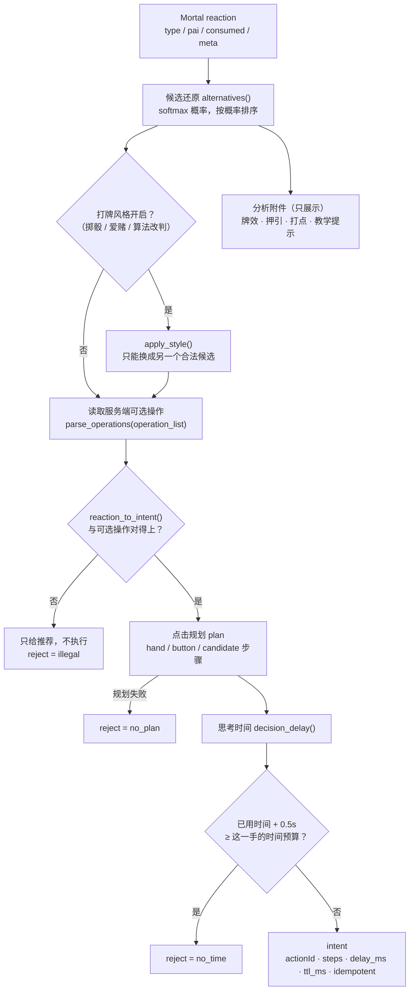

即使不执行（`reject ≠ null`），推荐也照样发给界面，辅助模式可以继续使用。

### 10.2 合法性校验（`decision/validate.py`）

- `parse_operations()` 把服务端 `operation_list` 翻译成 `LegalActions`：能不能打牌、哪些牌可以立直宣言（`liqi_tiles`）、吃 / 碰 / 杠的组合、能不能自摸 / 荣和 / 九种九牌。
- `reaction_to_intent()` 把 MJAI 反应映射到服务端操作类型（`protocol/optype.py`）：

  | 操作 | type | 操作 | type |
  |---|---|---|---|
  | 打牌 DAPAI | 1 | 加杠 ADD_GANG | 6 |
  | 吃 CHI | 2 | 立直 LIQI | 7 |
  | 碰 PENG | 3 | 自摸 ZIMO | 8 |
  | 暗杠 AN_GANG | 4 | 荣和 RONG | 9 |
  | 大明杠 MING_GANG | 5 | 九种九牌 JIUZHONG | 10 |

- 任何对不上（牌不在手里、组合不存在、服务端没给这个选项）→ 返回 `None`，**绝不抛异常、绝不猜**。
- 立直：Mortal 只说“立直”，宣言牌取**服务端允许、且候选概率最高**的那张（`_pick_riichi_tile`）。

### 10.3 点击规划（`decision/plan.py`）

规划只产出**抽象步骤**，不含像素坐标（坐标由外壳按画面大小换算，见 11.1）：

| 步骤 | 含义 |
|---|---|
| `{"t":"hand","index":i,"gap":bool}` | 点排序后手牌的第 i 张；`gap=true` 表示刚摸的那张（右边多一段间隔） |
| `{"t":"button","slot":k}` | 点操作按钮槽位 k；**槽位 0 永远是“跳过”** |
| `{"t":"candidate","index":i,"count":n,"kan":bool}` | 吃 / 碰 / 杠有多种组合时，在 n 个候选里点第 i 个 |

按钮从右下往左上排列；同时出现多个按钮时按优先级排序（`PRIORITY`：跳过 0、自摸 / 荣和 1、立直 / 大明杠 2、碰 / 暗杠 / 加杠 3、吃 4、九种九牌 5）。暗杠和加杠共用一个“杠”按钮，候选合并后再选。例如：

- 打牌：`[hand]`
- 立直：`[button(立直), hand(宣言牌)]`
- 有两种吃法的吃：`[button(吃), candidate(1 / 2)]`
- 不鸣：`[button(0)]`

### 10.4 思考时间（`decision/think.py`）

像人一样：有把握就快，犹豫就慢，但**绝不超时**。

<p align="center">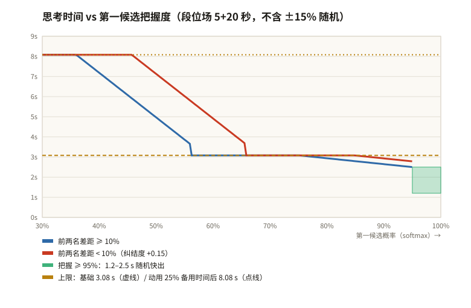</p>

```text
top ≥ 95%                       → 在 1.2–2.5 s 里随机
否则 u = (0.95 − top) / 0.65     （纠结度 0..1）
     前两名差距 < 10% → u += 0.15
     目标 = 2.5 s + u × (4.4 − 2.5) s，再乘 0.85–1.15 的随机系数
     u ≥ 0.6 且备用时间 ≥ 8 s → 再加上一部分备用时间（最多 25%，且至少留 4 s）
上限 = time_fixed − 1.5 s（安全余量）− 0.42 s × 点击步数（+ 允许动用的备用时间）
新一局第一打至少等 2 s（服务端要等所有人就绪，太早点击会被忽略）
```

> 图中 60% 附近的台阶来自这条规则：纠结度 u 越过 0.6 时才允许动用备用时间，上限从基础上限跳到含备用时间的上限。

发给外壳的 `delay_ms = 目标 − 已经过去的时间`（含推理耗时）；`ttl_ms = 这一手的时间预算 − 已用时间`。

### 10.5 打牌风格（可选，`decision/style.py`、`decision/arbiter.py`）

关闭时完全按模型第一名出牌。开启后可以在**模型给出的合法候选里**换一个：

| 风格 | 规则 |
|---|---|
| 掷骰 | 与第一名 q 值差 ≤ 0.61 的备选，按 $e^{-\Delta q / 0.3}$ 加权随机选一个；没有就选第一名。只在“几乎一样好”的局面偏离 |
| 爱赌 | 六条役满路线（国士、四暗刻、大三元、四喜、字一色、九莲）各算“离完成还差几张”，差距低于随巡目收紧的阈值时朝役满打 |
| 算法改判·软 | 模型犹豫（第一名 < 60%），算法看好的候选模型也给了 ≥ 15%，且算法价值高出 600 点 |
| 算法改判·硬 | 不管模型多有把握，放铳损失少 ≥ 2500 点、总价值也更高（候选概率 ≥ 3%） |
| 终局见逃 | 最后一局和了后仍是末位且对局就此结束 → 不和，等更大的牌 |

算法价值的口径（点数）：进攻价值 − 放铳损失；终盘把名次变化按 `[+15000, +5000, −5000, −20000]` 折成点数。风格改动会记在推荐的 `style` 字段里，复盘时仍以模型第一名计算一致率。

---

## 11. 执行层：模拟点击与“失败即停”

> 💡 **通俗地说**：外壳拿到“点手牌第 11 张”这样的指令，先换算成屏幕上的像素位置，然后像人一样：移过去、按下、松开。
> 每一步之前都会再确认一次“这个指令还有效吗？窗口还能点吗？”。点完以后，大脑要亲眼看到游戏发出了对应的操作才算数。

### 11.1 16×9 坐标系（`shared/ui-map.ts`）

游戏画面被**严格保持 16:9**，所以所有位置都可以用“画面宽度 / 16”为单位的坐标表达，与窗口大小无关。坐标取自 MahjongCopilot（GPL-3.0）的 Positions：

<p align="center">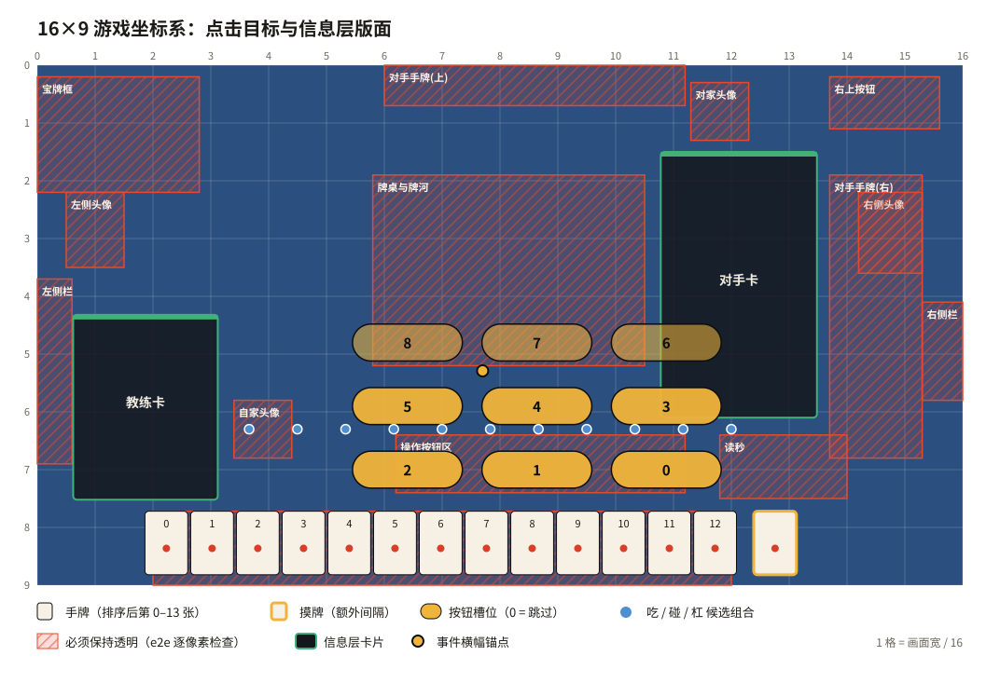</p>

```ts
toView(gx, gy, rect) = { x: rect.x + gx / 16 * rect.w, y: rect.y + gy / 9 * rect.h }
```

- 手牌中心 `TEHAI_X[0..13]`、`TEHAI_Y = 8.3625`，刚摸的牌再往右 `TRUMO_SPACE = 0.246875`。
- 按钮 9 个槽位、吃碰候选 11 个位置、杠候选 7 个位置。
- 槽位越界 → `SlotOutOfRange`，整次执行失败而不是点到别处。
- `UI_MAP_VERSION` 记录坐标对应的游戏版本，游戏改版后在这一个文件里调整。

### 11.2 ClickExecutor（`src/main/click-executor.ts`）

```text
等待 preDelayMs（= delay_ms，且不超过 ttl − 0.42 s × 步数 − 1 s）
对每一步：
  ① intent 仍是当前的？窗口没有最小化 / 销毁？        否 → 中止（aborted）
  ② 换算坐标（越界 → 失败）
  ③ 第一步之前通知 Core：action.begin
  ④ mouseMove → 等 60 ms → 再检查 ① → mouseDown → 按住 80 ms → mouseUp
  ⑤ 步与步之间等 250 ms
全部完成 → action.result ok
```

两种点击后端（设置 `clickBackend`）：

| 后端 | 方式 | 特点 |
|---|---|---|
| `cdp`（默认） | `Input.dispatchMouseEvent` | 窗口失焦、在别的桌面（macOS Space）时也能点 |
| `sendInputEvent` | Electron 的 `webContents.sendInputEvent` | 备选 |

“能不能点”只看**最小化 / 已销毁**（`windowCanClick`）。不能用 `isVisible()`：macOS 上窗口被遮挡或在另一个桌面时它也返回 false。

### 11.3 intent 的一生（`core/session.py`）

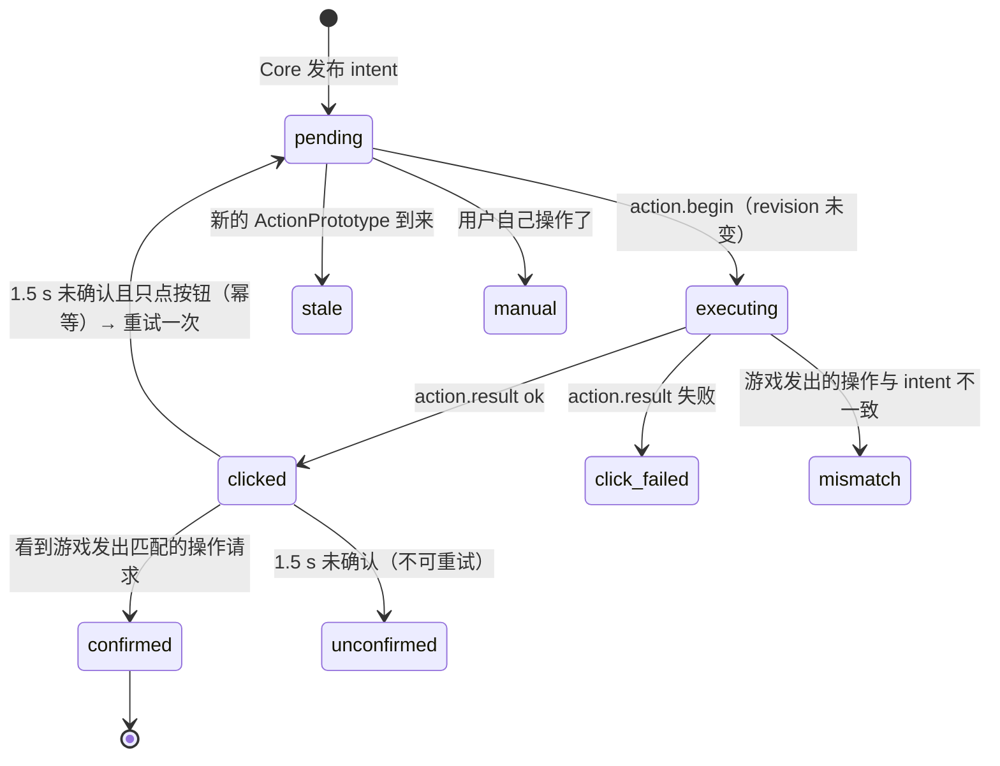

- **确认靠观察**：`_observe_out()` 看到出方向的 `inputOperation / inputChiPengGang`，比较操作类型（不鸣则看 `cancel_operation`）。
- **幂等重试**：只有全部步骤都是按钮时（`idempotent`）才允许重试一次；点手牌不重试，避免重复打牌。
- **用户手动操作**：没在执行时看到操作请求 → 取消当前 intent（`manual`），把控制权交还给人。

### 11.4 暂停与自动恢复

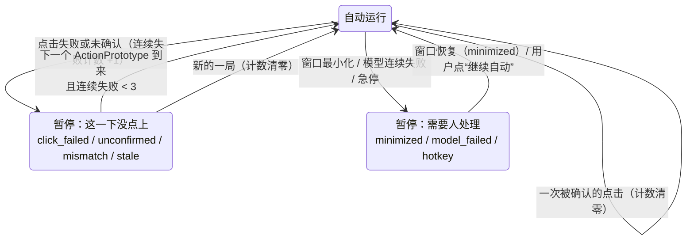

- `MAX_AUTO_RECOVER = 3`：连续 3 次失败中间没有任何一次被确认，说明点击位置或环境有问题，停住等下一局或用户处理，避免一直乱点。
- 急停：全局快捷键 `Ctrl/Cmd+Shift+Space` → 立即回到辅助模式。
- 切到自动（或恢复）时，如果当前正有一个还没执行的决策且剩余时间 ≥ 1.8 s，会立即接手（`_takeover`），不必等下一巡。

---

## 12. 分析模块：牌效、防守、打点、押引

> 💡 **通俗地说**：除了 AI 的建议，大脑还用传统麻将知识算了一遍“为什么”：打哪张离听牌最近、哪张牌对谁危险、
> 听牌了值多少分、现在该攻还是该守。这些**只用来展示和教学**，不会改变 AI 的选择（除非你开启了算法改判）。

| 模块 | 输入 | 输出 |
|---|---|---|
| `analysis/efficiency.py` | 34 维计数 | 向听数（普通型 / 七对 / 国士）、待牌、进张、和牌率估算 |
| `analysis/groups.py` | 手牌 | 拆成 顺子 / 刻子 / 雀头 / 两面 / 嵌张 / 边张 / 对子 / 孤张，标出每个搭子的待牌与余张 |
| `analysis/defense.py` | 牌河、副露、立直、宝牌 | 每家威胁度、每张牌的综合放铳率与 0–4 危险等级、原因码 |
| `analysis/value.py` | 听牌形 | 每张待牌 荣和 / 自摸 / 立直后荣和 的番符点数（`mahjong` 库） |
| `analysis/attack.py` | 局面 | 默听 vs 立直的和牌率、平均打点、期望值；押引红绿条（收益 vs 损失） |
| `analysis/board.py` | 以上 | 候选打牌的牌效对比、攻 / 平 / 弃结论 |
| `analysis/teach.py`、`knowledge.py` | 以上 | 1–3 条结构化“为什么”和规则知识点（界面按语言渲染） |

### 12.1 向听数

普通型按“每种数牌能拆出的 (面子数, 搭子数) 帕累托最优集合”组合四种花色（数牌带记忆化，字牌单独算），
`shanten = 8 − 2 × 面子 − 搭子`（搭子数受 4 − 面子 限制），再枚举每一种雀头取 −1 后的最小值；门清时还要算七对子 `6 − 对子数 + max(0, 7 − 种类数)` 与国士 `13 − 幺九种类 − (有幺九对子 ? 1 : 0)`，三者取最小。

### 12.2 放铳率（`defense.py`）

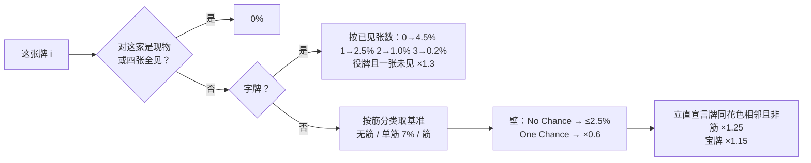

| 数字 | 1 | 2 | 3 | 4 | 5 | 6 | 7 | 8 | 9 |
|---|---|---|---|---|---|---|---|---|---|
| 无筋 % | 6.5 | 8.0 | 10.0 | 12.0 | 13.0 | 12.0 | 10.0 | 8.0 | 6.5 |
| 筋 % | 1.8 | 3.0 | 4.5 | 3.5 | 3.5 | 3.5 | 4.5 | 3.0 | 1.8 |

这是对“已听牌对手”的放铳率。没立直的对手再乘**威胁度**（≈ 已听牌的概率）：立直 1.0；3 副露 0.75、2 副露 0.45、1 副露 0.2；门清 `min(0.3, 0.05 + 0.02 × 巡目)`；副露里有役牌刻子或宝牌 +0.15；9 巡后连续 3 张手切 +0.1；上限 0.95。

综合放铳率（对所有对手）：

$$\text{risk}_i = 1 - \prod_{\text{对手 } o} \left(1 - \text{deal\_in}_o(i) \times \text{threat}_o\right)$$

等级：`0` 安全（0%）、`1` < 2%、`2` < 5%、`3` < 9%、`4` 极危。

### 12.3 押引结论（`board.py: verdict`）

| 打后向听 | 条件 | 结论 |
|---|---|---|
| 听牌 | 最大威胁 < 0.5 或这张放铳率 < 3% | 攻 |
| 听牌 | 最大威胁 ≥ 0.8 且放铳率 ≥ 8% | 弃 |
| 听牌 | 其它 | 平 |
| ≥ 2 向听 | 最大威胁 ≥ 0.8 | 弃 |
| 1 向听 | 最大威胁 ≥ 0.8 | 平 |
| 其它 | 最大威胁 < 0.5 → 攻，否则平 | |

押引红绿条（`attack.py: balance`）：和牌收益 = 期望值（听牌时 和牌率 × (平均打点 + 供托) − 立直棒成本；未听牌按向听与进张估算并标记 `est`），放铳损失 = Σ 对手放铳率 × 对手估计打点。

---

## 13. 界面：主窗口、侧栏与游戏内信息层

> 💡 **通俗地说**：窗口左边是游戏（永远保持 16:9 不变形），右边是侧栏。游戏上面还盖着一块**透明玻璃**（信息层），
> 提示都画在玻璃上；鼠标点击会穿过玻璃直接点到游戏，只有停在玻璃上的提示卡片时，卡片才接收点击。

### 13.1 窗口布局（`src/main/layout.ts`、`src/shared/layout-fit.ts`）

<p align="center">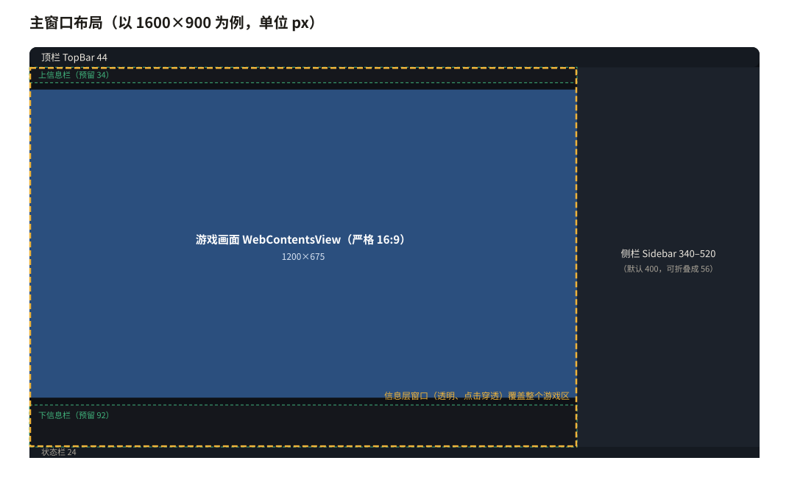</p>

- 游戏区 = 顶栏（44）与状态栏（24）之间、侧栏左边的整块区域。
- `fitGame(areaW, areaH, {reserve, dock})`：开启“预留信息栏”时先在上下各留 34 / 92 px，再把 **严格 16:9** 的游戏画面放进剩余空间；多出来的空间上下平分（`split`）或全给下方（`bottom`）。
- **主进程摆游戏视图、信息层窗口排版用的是同一个函数**，所以信息层里的坐标与游戏画面永远对齐。
- 侧栏宽 340–520（默认 400），可折叠成 56 的图标栏。

### 13.2 渲染层结构

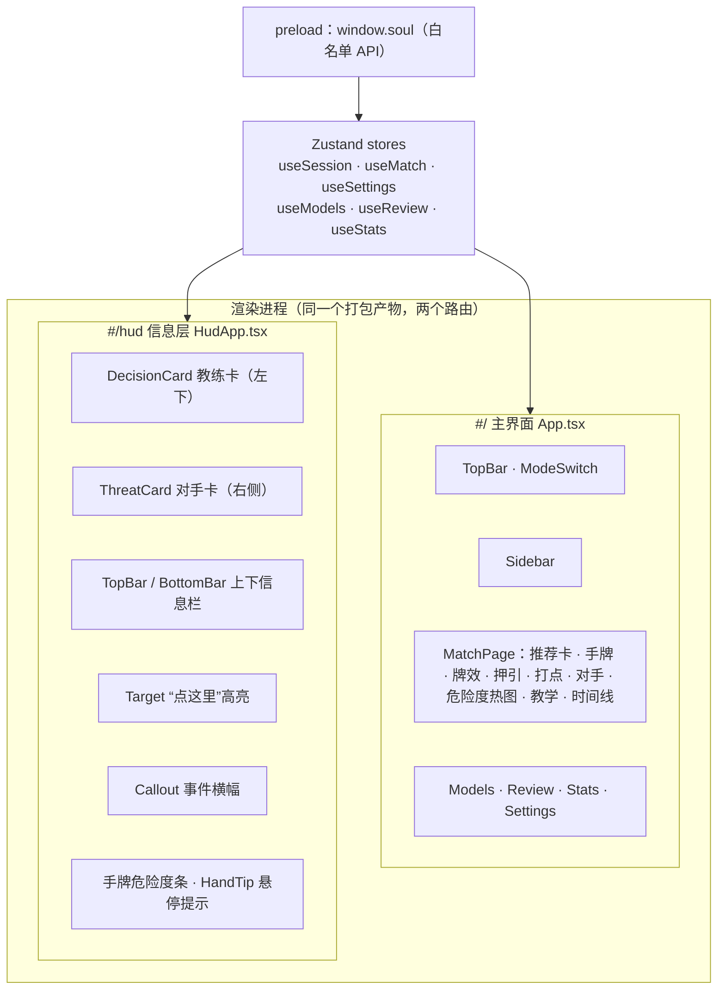

- **单向数据流**：主进程把每条 Core 消息转发给两个渲染进程 → `applyCoreMessage()` 写进 Zustand store → 组件订阅渲染。
- **练习模式的“判卷”在渲染层**：看到自家牌河多了一张，就和刚才的推荐比较（`judgeDiscard`），累计一致率、连击、失误和价值损失。
- preload 只暴露固定的方法（`getSettings / patchSettings / setMode / stopAuto / importModel / …`），渲染层没有 Node 权限（`sandbox + contextIsolation`）。

### 13.3 信息层窗口（`src/main/overlay.ts`）

| 特性 | 实现 |
|---|---|
| 透明、无边框、不抢焦点 | `transparent`, `frame:false`, `focusable:false`, `showInactive()` |
| 默认点击穿透 | `setIgnoreMouseEvents(true, { forward: true })`：点击穿过去，鼠标移动仍转发（用于悬停手牌提示） |
| 卡片可交互 | 鼠标停在卡片上 → 渲染层发 `hud:interactive(true)` → 暂时接收点击；离开立即恢复穿透 |
| 覆盖整个游戏区 | `place()` 把游戏区（含上下信息栏）换算成屏幕坐标 |
| 只在需要时显示 | 已开启 + 辅助 / 自动模式 + 局内 + 窗口未最小化 |

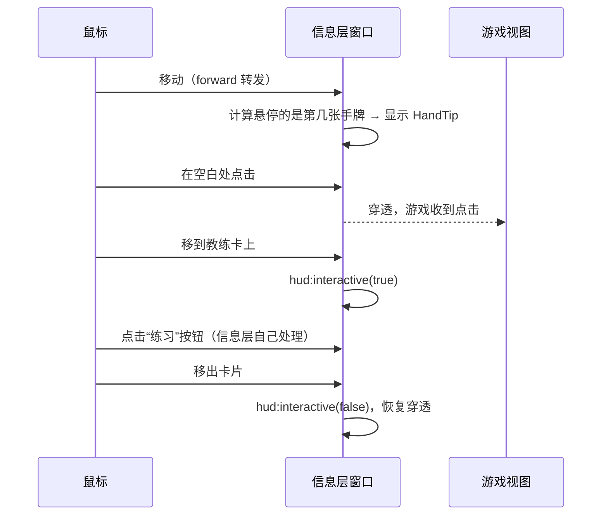

### 13.4 信息层版面与“不遮挡”

版面（`hud/zones.ts`）以 16×9 坐标定义，避开真实对局截图里量出来的关键区域：牌桌与牌河、操作按钮、吃杠候选行、读秒、手牌行、四家头像、宝牌框、两侧按钮、对手手牌墙（见第 11.1 节的坐标图中红色斜线区域）。

`pnpm e2e:hud` 会把每个场景渲染成带透明通道的 PNG，**逐像素断言这些区域的 alpha 全为 0**，并在 1.1 倍缩放、更矮的窗口等极端情况下重复检查。

信息层的内容：

| 组件 | 内容 |
|---|---|
| 教练卡 DecisionCard | 推荐牌 + 动作大字 + 把握度环、向听进度（3+ · 2 · 1 · 听 · 和）、放铳率与押引标签、一句话理由、候选对比表（AI 概率 / 打后向听 / 进张 / 放铳率，◎ = 第一名）；悬停展开全部理由与本局失误 |
| 对手卡 ThreatCard | 每家风位（亲 = 朱底）、名次、点差、十格听牌可能、立直判子、理由、对他安全的牌；底部 弃 · 平 · 攻 三格结论 |
| 上信息栏 | 局况、本场 / 供托 / 余牌 / 巡目、名次章与上下差、All Last 提示、四家点数（立直者画一根点棒） |
| 下信息栏 | 手牌分组（顺子 / 刻子 / 雀头 / 搭子与待牌余张）、听牌时每张待牌的打点、副露、押引红绿条 |
| Target | 在要点的牌 / 按钮上画实色框和“札”（动作名），每个新推荐“拍”下来一次 |
| Callout | 听牌、连击、换个思路（失误）、对手立直、名次变化时弹出的横幅，约 2 秒消失 |
| 危险度条 / HandTip | 每张手牌上方一条五档颜色；悬停显示原因、打后牌效与 AI 概率 |

### 13.5 视觉语言「和・卓上」

扁平、实色块、细分隔线，不发光、不渐变。颜色只承载含义（`styles/tokens.css` 的 `--wa-*`）：

| 颜色 | 传统色名 | 含义 |
|---|---|---|
| `#e5492f` | 朱 | 危险、立直、失误 |
| `#f0b43a` | 山吹 | 立直建议、一位、和了目标 |
| `#3fb27b` | 青竹 | 推荐打牌、安全、进攻 |
| `#4f8fd0` | 藍 | 鸣牌、教学 |
| `#e33f62` | 紅 | 和牌 |
| `#15171c` / `#f3eee1` | 墨 / 生成り | 卡片底 / 文字（浅色主题互换为和纸底、墨字） |

动效是短促的“拍牌 / 盖章”（200–340 ms，不循环），`prefers-reduced-motion` 时全部关闭。

---

## 14. 自动匹配：看画面找按钮

> 💡 **通俗地说**：一局结束后，结算页有好几页要点“确认”。程序每 2.5 秒看一眼游戏画面，
> 认出“黄色的确认按钮”“蓝色的再来一场”这些颜色块，就点它；进了下一局再交给自动打牌。

- **不注入脚本、不伪造消息**：只截图（`capturePage`）+ 颜色采样 + 同一条点击通道。
- 颜色判定（BGRA 采样，避开按钮中间的文字）：黄色「確認」`r>200, g>150, b<150, r−b>95`；蓝色「再來一場 / 取消」`b>110, b−r>60, r<95, g<120`；采样点 ≥ 55% 命中才算。
- 兜底：如果没出现“再来一场”，回到大厅按上次的场次依次点 段位场 → 铜 / 银 / 金 / 玉 / 王座 → 东 / 南（玉、王座要先滚动滚轮）。场次由 `NotifyMatchGameStart.match_mode_id` 记住。

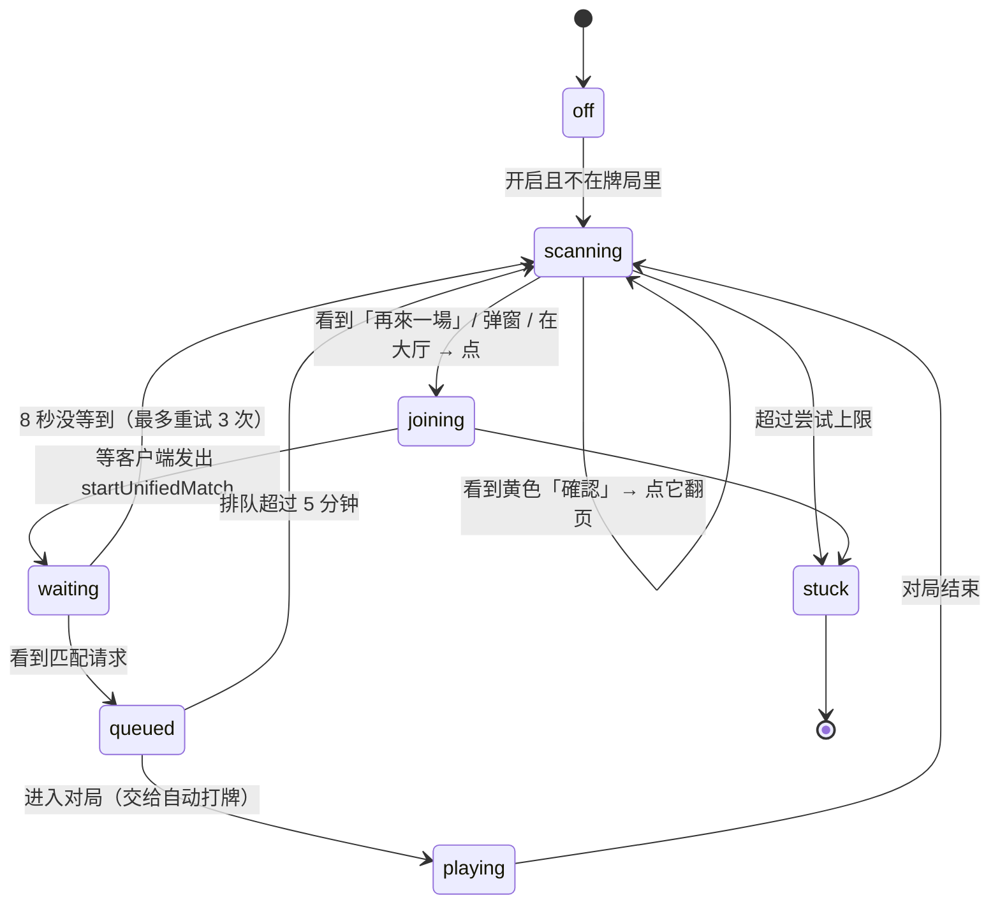

---

## 15. 数据、模型与安全边界

### 15.1 数据目录（`src/main/paths.ts`）

优先级：环境变量 `MAJSOUL_BROWSER_DATA_DIR` → 开发模式仓库里的 `.data/` → macOS `.app` 所在目录 → Linux AppImage 文件旁 → Windows / Linux 可执行文件旁。启动时创建子目录并**写入探测**，不可写就弹窗说明，不会悄悄换到别处。

```text
MajsoulBrowserData/
├── settings.json        设置（原子写：先写 .tmp 再 rename）
├── profile/             Chromium 用户数据：雀魂登录 Cookie、缓存
├── models/              <sha256>.pth + manifest.json
├── records/             对局记录 game-*.jsonl、原始帧 frames-*.jsonl
├── logs/  tmp/  crash/
```

macOS 从“下载”文件夹直接运行时会被系统放进只读的隔离路径（AppTranslocation），程序会识别并提示移动位置。

### 15.2 模型导入（`core/models.py`）

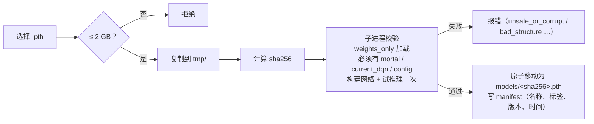

校验放在**子进程**里做：即使模型文件有问题导致崩溃，也不影响 Core。

### 15.3 对局记录（`core/records.py`、`src/main/recorder.ts`）

一局一个 JSONL：`start`（uuid、座位）→ `event`（MJAI 事件）→ `rec`（推荐与全部候选 q 值）→ `exec`（执行结果）→ `end`。复盘页（`review.py`）据此算出每一手是否与模型一致、失误与价值损失；统计页汇总历史对局。原始帧可以另外录下来，作为回放测试的素材（含账号信息，不进 Git）。

### 15.4 安全清单

| 项 | 做法 |
|---|---|
| 协议 | 只读；静态检查 + 运行时白名单 |
| 网页沙箱 | 游戏视图、主界面、信息层都开启 `sandbox`、`contextIsolation`，`nodeIntegration:false` |
| 导航 | 游戏视图只允许雀魂相关域名；主界面与信息层禁止任何导航和弹窗 |
| 权限 | 摄像头、麦克风、通知等权限请求一律拒绝 |
| 模型 | `weights_only=True`，拒绝任意代码；子进程校验 |
| 调试接口 | 进程内 CDP，不开端口 |
| 系统 | 不改代理、不装证书、不写用户目录 |

---

## 16. 多语言

- 渲染层：`renderer/i18n/{zh-CN,en,ja,ko,de}.ts`，类型 `Messages = typeof zhCN`，**其它语言必须拥有完全相同的键**，否则 `tsc` 报错。
- 主进程：`src/main/i18n.ts`（菜单、系统对话框、启动错误），切换语言时重建菜单。
- 首次运行按系统区域选择语言（`shared/lang.ts: pickLang`），之后跟随设置。
- Core 不产生面向用户的句子：教学提示、知识点、暂停原因都是**结构化代码**（`{"code":"suji","tile":"5m"}`），由界面按语言渲染。
- 术语词典（`gloss.*`）：界面文字里出现的术语自动加下划线，悬停显示解释。

---

## 17. 构建、打包与发布

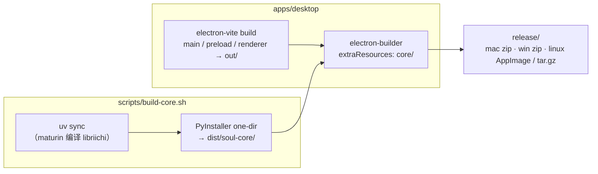

| 目标 | 命令 | 说明 |
|---|---|---|
| macOS Apple Silicon | `scripts/package.sh mac-arm64` | |
| macOS Intel | `scripts/package.sh mac-x64` | 在 Apple Silicon 上用 Rosetta 2：独立的 x86_64 虚拟环境、`CARGO_BUILD_TARGET=x86_64-apple-darwin` |
| Windows x64 | `scripts/package.sh win` | 必须在 Windows 上（Git Bash） |
| Linux x64 | `scripts/package.sh linux` | 必须在 Linux 上 |

平台相关依赖（`core/pyproject.toml`）：

| 平台 | torch | numpy | 原因 |
|---|---|---|---|
| macOS Intel | 2.2.2 | 1.26 | PyTorch 2.2 之后不再提供 macOS x86_64 轮子，2.2 又只兼容 numpy 1.x |
| Linux | `+cpu`（PyTorch 官方 CPU 源） | ≥ 2 | PyPI 默认带 CUDA（数 GB） |
| macOS arm64 / Windows | PyPI 默认（CPU） | ≥ 2 | |

运行时：打包后 Core 是 `resources/core/soul-core(.exe)`；同一个可执行文件通过子命令充当推理子进程（`soul-core runner`）和模型工具（`soul-core models`）。开发时则用 `core/.venv` 的 Python 运行 `-m soul_core.main`。

应用图标：`apps/desktop/scripts/make-icon.cjs` 用离屏 Electron 渲染 SVG，生成 `build/icon.png`（安装包用）与 `resources/icon.png`（开发时的 Dock / 窗口图标），运行 `pnpm icon`（需要 macOS 自带的宋体）。

GitHub Actions：

- `ci.yml`：每次推送在 macOS / Windows / Linux 上跑 Core 测试、前端类型检查与测试、只读检查。
- `release.yml`：手动触发，在四个原生环境上打包并上传 Artifacts；勾选 `draft` 时创建**草稿** Release，不会自动公开。

---

## 18. 测试体系

| 层 | 命令 | 覆盖 |
|---|---|---|
| Core 单元 / 集成 | `uv run pytest` | 协议解码、状态机（合成牌局与真实抓包回放）、合法性映射、点击规划、思考时间、风格与改判、牌效 / 防守 / 打点、复盘统计、stdio 协议、失败即停；需要模型的用例在没有模型时自动跳过 |
| 前端单元 | `pnpm test`（vitest） | 点击坐标、布局、CoreClient 监督（真实子进程）、自动匹配状态机与颜色判定、练习判卷、事件横幅、术语切分、语言选择、数据目录 |
| 类型 | `pnpm typecheck` | 包括五种语言键一致 |
| 点击端到端 | `pnpm e2e:click` | 真实鼠标事件打到假 Canvas 页面，核对坐标、失焦窗口、零重复点 |
| 信息层端到端 | `pnpm e2e:hud` | 逐像素检查不遮挡关键区域 |
| 布局端到端 | `pnpm e2e:layout` | 最小窗口下侧栏可滚动 |
| 视觉 | `pnpm design:shots` / `design:hud` | 各状态截图，人工检查 |
| 只读 | `scripts/verify-readonly.sh` | 静态检查 |
| 冒烟 | `SOUL_SMOKE_SECONDS=20 ./Majsoul-Browser` | 打包产物启动后输出 Core 状态、帧数、信息层是否就绪 |

---

## 19. 从零复刻路线图

如果要从一个空目录重新实现，建议按下面的顺序，每一步都能独立验证：

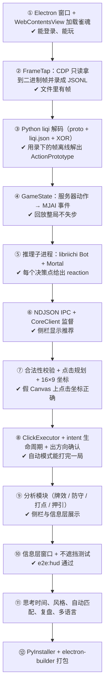

几个容易踩的坑：

1. **CDP 的启动顺序**：先 `about:blank`，再 attach，再导航（第 5.1 节）。
2. **焦点**：不做焦点模拟，切到别的软件后点击无效。
3. **后台节流**：不关掉 Chromium 的后台降频，窗口被遮挡后游戏会停。
4. **手牌顺序**：点击用的是客户端显示顺序（赤五在普通五之前），不是服务端数组顺序。
5. **立直宣言**：Mortal 只给“立直”，宣言牌要从服务端允许的牌里另选。
6. **确认**：点完不等于成功，必须看到游戏发出的操作请求。
7. **Windows 管道**：`select()` 不能等管道，用读线程。
8. **macOS 可见性**：`isVisible()` 在窗口被遮挡 / 在其它桌面时为 false，不能用来判断能否点击。

---

## 20. 已知限制与扩展点

| 限制 | 说明 |
|---|---|
| 只支持四人麻将 | 三麻会进入 `unsupported_mode`，所有功能关闭 |
| 坐标依赖游戏版本 | 游戏改版后可能需要更新 `shared/ui-map.ts` 和 `hud/zones.ts` |
| 分析是近似值 | 放铳率、威胁度、期望值都是经验估计，用于教学和排序 |
| 不含模型 | 需要用户自备 Mortal 格式的模型 |
| 未签名 | macOS / Windows 首次打开会有系统提示 |
| Core 少量提示仍为中文 | 部分错误提示（`hint`）来自 Core，尚未结构化 |

扩展点：

- **新的点击目标**：在 `ui-map.ts` 加坐标，在 `plan.py` 加步骤类型。
- **新的分析**：在 `analysis/` 加纯函数，挂到 `decide.py: _attach_insight`，前端在 `protocol.ts` 补类型。
- **新的教学提示**：`teach.py` 产出新的 `code`，五种语言的 `tips.*` 补文案。
- **新的语言**：复制 `en.ts` 翻译，在 `shared/lang.ts` 与 `main/i18n.ts` 注册。
- **更换 AI**：只要推理子进程遵守“每行一个 MJAI 事件 → 每行一个反应（含 `meta.q_values / mask_bits`）”的约定即可替换。

---

<sub>示意图：Mermaid 图由 GitHub 直接渲染；`images/diagrams/*.svg` 由 `images/diagrams/gen_svg.py` 根据源码常量生成，修改相关常量后请重新运行。</sub>
